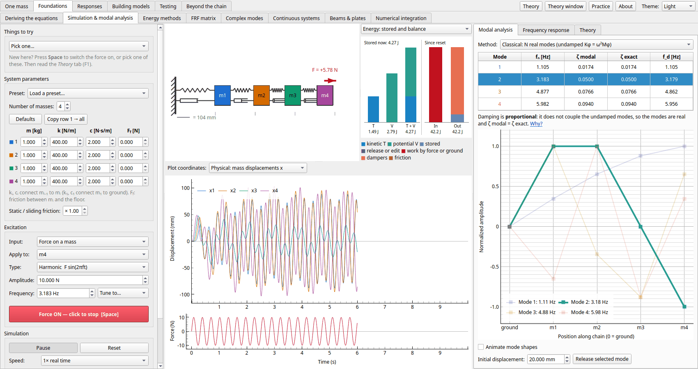

# Vibration Tutorial

An interactive, real-time teaching tool for multi-degree-of-freedom mechanical vibration.
It simulates a chain of lumped masses connected by springs and dampers, animates the
motion, and shows the modal-analysis solution for reference, all updating live while
you change parameters.

> **Disclaimer:** This entire project was created with [Claude Code](https://claude.com/claude-code).
> It is for educational use only, with no warranty, and its results are not guaranteed to be
> technically correct (see [Disclaimer and license](#disclaimer-and-license)).

```
ground ──[k1,c1]── m1 ──[k2,c2]── m2 ──[k3,c3]── m3 ──[k4,c4]── m4
```



## Quick start

Standalone builds for Windows, macOS (Apple Silicon) and Linux, which need no Python
install, are on the [Releases](https://github.com/WookieLumberjack/vibration-tutorial/releases)
page. They aren't code-signed; the release notes say how to open them past the system's
warning.

To run from source instead, you need [uv](https://docs.astral.sh/uv/) and a
[Rust toolchain](https://rustup.rs/) (uv builds the app's Rust kernels, in `native/`, on
the first sync).

```bash
uv sync               # create .venv and install dependencies
uv run vib-tutorial   # launch the app (or: uv run python -m vib_tutorial)
uv run pytest         # run the tests
uv run ruff check     # lint (and `uv run ruff format` to format)
uv run mypy           # type-check
uvx pre-commit install  # run ruff and mypy before each commit
```

## Contents

The course runs through six groups of pages, in the order the app's tabs take them: each page uses only ideas from the pages before it.

**[One mass](docs/one-mass.md)**

- [Single oscillator](docs/one-mass.md#single-oscillator): one mass on a spring and a damper: free decay, damping, resonance, half-power, beats, poles
- [Pendulums](docs/one-mass.md#pendulums): gravity as the spring, large swings that soften, and the rotational form of every one-mass formula
- [Transient response](docs/one-mass.md#transient-response): an impulse, a step or a pulse: the impulse response, convolution, and how long a pulse has to be
- [Periodic forcing](docs/one-mass.md#periodic-forcing): a repeating force as a Fourier series: harmonics, Gibbs, resonance through a harmonic
- [Damping models](docs/one-mass.md#damping-models): viscous, hysteretic, friction and viscoelastic damping: their loops, losses and decays
- [Vibration isolation](docs/one-mass.md#vibration-isolation): a machine on mounts: transmissibility, static deflection, damping, two stages, start-up

**[Foundations](docs/foundations.md)**

- [Deriving the equations](docs/foundations.md#deriving-the-equations): free-body diagrams against Lagrange's equations: a car in bounce and pitch, and a double pendulum
- [Simulation & modal analysis](docs/foundations.md#simulation--modal-analysis): one mass, then a chain of them: modes, damping, energy, forcing, absorbers, friction
- [Energy methods](docs/foundations.md#energy-methods): Rayleigh, Dunkerley, Rayleigh–Ritz and Holzer: frequencies from the energies, and how good they are
- [FRF matrix](docs/foundations.md#frf-matrix): every receptance H<sub>jk</sub>, and how the modes add up to it
- [Complex modes](docs/foundations.md#complex-modes): when damping makes the modes complex, and what the usual approximation misses
- [Continuous systems](docs/foundations.md#continuous-systems): a string, a bar or a beam cut into a chain: which of its modes to trust
- [Beams & plates](docs/foundations.md#beams--plates): Timoshenko's thick beam, a plate's modes and nodal lines, and modal density
- [Numerical integration](docs/foundations.md#numerical-integration): central difference, Newmark, HHT-α and Runge–Kutta against the exact update: stability, period error, numerical damping

**[Responses](docs/responses.md)**

- [Random vibration](docs/responses.md#random-vibration): a random force or base: the response's spectrum, RMS and peaks
- [Fatigue](docs/responses.md#fatigue): a random stress counted by rainflow: S–N curves, Miner's rule, narrow-band and Dirlik estimates
- [Quarter-car](docs/responses.md#quarter-car): a suspension on an ISO 8608 road: comfort, grip and travel from the road's PSD
- [Rigid body on mounts](docs/responses.md#rigid-body-on-mounts): a machine on four mounts in 3D: six coupled modes, the elastic centre, and decoupling by tilting them
- [Shock spectrum](docs/responses.md#shock-spectrum): a short pulse on a bank of oscillators, and on the chain
- [Seismic response](docs/responses.md#seismic-response): the chain as a building: a design spectrum, effective modal mass, and ABS, SRSS and CQC against records
- [Vibro-acoustics & SEA](docs/responses.md#vibro-acoustics--sea): a panel's sound: radiation efficiency, coincidence, the mass law, and energy flow between parts

**[Building models](docs/building-models.md)**

- [Modal coupling](docs/building-models.md#modal-coupling): two parts joined, one mode each: when their modes split
- [Substructuring (CMS)](docs/building-models.md#substructuring-component-mode-synthesis): a chain reduced to a few modes per part, and back
- [Frame builder](docs/building-models.md#frame-builder): build a frame or truss from beams, bars and springs: assembly, supports, modes

**[Testing](docs/testing.md)**

- [Signals & spectra](docs/testing.md#signals--spectra): sampling, aliasing, leakage, windows and averaging, and the transducers that make the signals
- [Virtual modal test](docs/testing.md#virtual-modal-test): measuring the FRF from force and response signals, and fitting modes
- [Operational modal analysis](docs/testing.md#operational-modal-analysis): the modes from the responses alone, the forces unknown
- [Model updating](docs/testing.md#model-updating): comparing a model with a test, and correcting it
- [Test planning](docs/testing.md#test-planning): where to put the sensors, and what the structure does as it runs
- [Nonlinearity & forces](docs/testing.md#nonlinearity--forces): is the structure linear (levels, sweeps, harmonics), and which force made a response
- [Variability & localization](docs/testing.md#variability--localization): scatter in the chain's properties by Monte Carlo, and modes localized in a mistuned ring of blades

**[Beyond the chain](docs/beyond-the-chain.md)**

- [Torsional vibration](docs/beyond-the-chain.md#torsional-vibration): a drive train of discs, shafts and gears, and its start-up
- [Duffing & Mathieu](docs/beyond-the-chain.md#duffing--mathieu): a nonlinear spring: jumps, chaos, and parametric resonance
- [Fluid–structure](docs/beyond-the-chain.md#fluidstructure): a body in water: added mass of spheres, cylinders, tubes in pipes and plates, wet against dry
- [Self-excited vibration](docs/beyond-the-chain.md#self-excited-vibration): negative damping and limit cycles: van der Pol, galloping, vortex-induced vibration and flutter
- [Active control](docs/beyond-the-chain.md#active-control): velocity feedback, collocation, spillover and actuator lag, against a tuned mass damper
- [Gyroscope](docs/beyond-the-chain.md#gyroscope): a spinning top: Euler's equations, steady precession, nutation and the sleeping top
- [Jeffcott rotor](docs/beyond-the-chain.md#jeffcott-rotor): a spinning shaft: critical speeds, balancing, bearings, stability, rub
- [Rotor builder](docs/beyond-the-chain.md#rotor-builder): build a rotor from shafts, discs, bearings and seals: its whirl modes, criticals and stability
- [Machinery diagnostics](docs/beyond-the-chain.md#machinery-diagnostics): order tracking under a run-up, gear-mesh sidebands, bearing defects by the envelope, and the cepstrum

**Reference**

- [The window](docs/the-window.md): the panes, the tabs, the Theory and Practice windows, and the themes
- [The math, briefly](docs/the-math.md): the equations behind the Simulation page
- [Code layout](docs/code-layout.md): the modules, the Rust kernels, and scripting the core

## Disclaimer and license

This software is provided for **educational purposes only**. It was written with an AI coding
assistant, [Claude Code](https://claude.com/claude-code), and although it has an automated test
suite, its results are **not guaranteed to be technically correct**: the simulations, modal
analysis, substructuring, identification and theory notes may contain errors. Validate any
calculation independently (by hand, with established references or with qualified software)
before relying on it, and do not use it for design, certification, safety-related or other
engineering decisions.

The software is provided **"as is", without warranty of any kind**, express or implied,
including the warranties of merchantability, fitness for a particular purpose and
non-infringement. In no event shall the authors or copyright holders be liable for any claim,
damages or other liability arising from the software or its use.

Released under the [MIT License](LICENSE). Copyright (c) 2026 WookieLumberjack.
