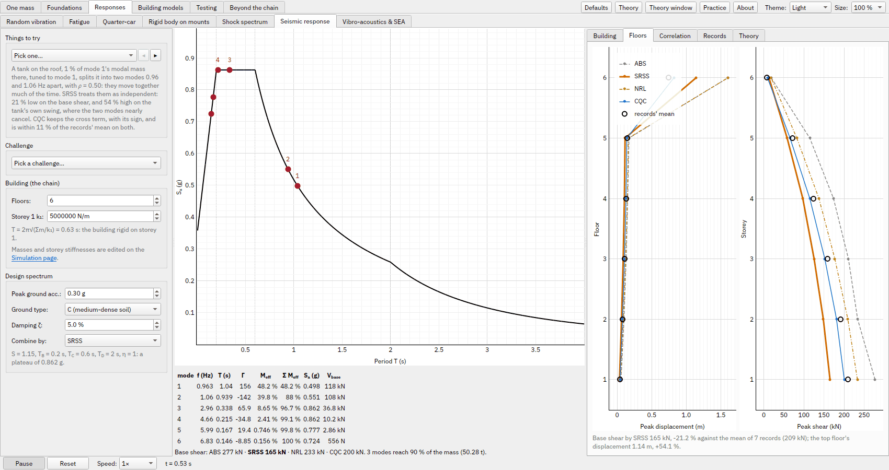

← [Control](control.md) · [Contents](../README.md#contents)

# Appendix

Pages to be folded into others later. Until then they stay here, read after the rest.

The pages in the order the app's tabs take them.

- [Seismic response](#seismic-response): the chain as a building: a design spectrum, effective modal mass, and ABS, SRSS and CQC against records
- [Nonlinearity & forces](#nonlinearity--forces): is the structure linear (levels, sweeps, harmonics), and which force made a response

## Seismic response

The chain as a shear building on the ground: a design spectrum in the European code's shape, each
mode's participation and effective mass, peak floor displacements, drifts and story shears from the
spectrum, combined by ABS, SRSS, NRL or CQC, against seven records synthesized to match the spectrum and
stepped exactly. A roof tank tuned to mode 1 shows why close modes need CQC; a soft story and base
isolation are trials too, and the notes cover drift limits, ductility and the behavior factor. The
*Building* tab plays the building swaying under the first record, scrubbed with a time cursor, each story's
columns reddening as its drift nears the record's largest: the soft story and the bearings light up. Story
1's stiffness has a box of its own, with the period of the building as a rigid block on it, and a challenge
asks for the bearings that bring the shear above them under a limit without letting them move too far.

## Nonlinearity & forces

Two checks a test needs. **Is it linear?** The chain, with its own friction and a cubic spring or a gap the
page adds alongside one spring, is driven by a stepped sine at three levels, swept up and then down (harmonic
balance at each step, from the last step's state, with each element's describing function): a linear chain's
six FRFs lie on one curve; a hardening spring's peak leans and jumps at different frequencies each way, a gap
does nothing until it closes, and friction's FRF rises with the level. The *Distortion* tab steps the chain in
time at one point (the exact FOH update, the nonlinear forces found by Newton) and shows the odd harmonics a
symmetric nonlinearity makes. **Which force made this response?** An impact, two, or a random burst on one
mass is measured with noise at chosen sensors (displacement or acceleration); y = Gf, G from the FOH
update's Markov parameters, and f is found plainly (useless: G's singular values span nearly 8 decades, beyond two that are zero to round-off), by
truncated SVD, or by Tikhonov with λ from the L-curve's corner or the noise. The *Singular values* tab is the
Picard plot. An accelerometer on the force's own mass brings G down to 3 decades and the error to 6 %.

---

← [Control](control.md) · [Contents](../README.md#contents)
