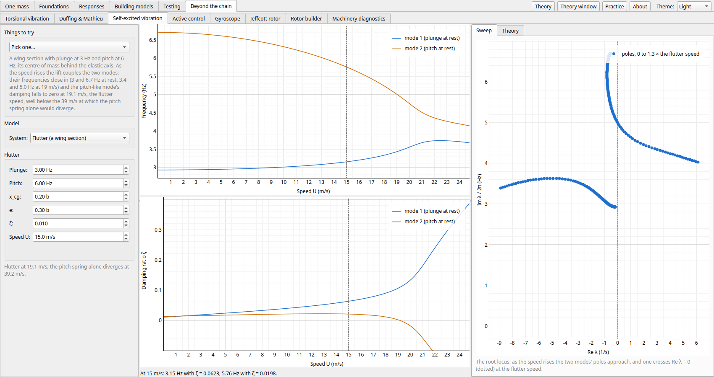
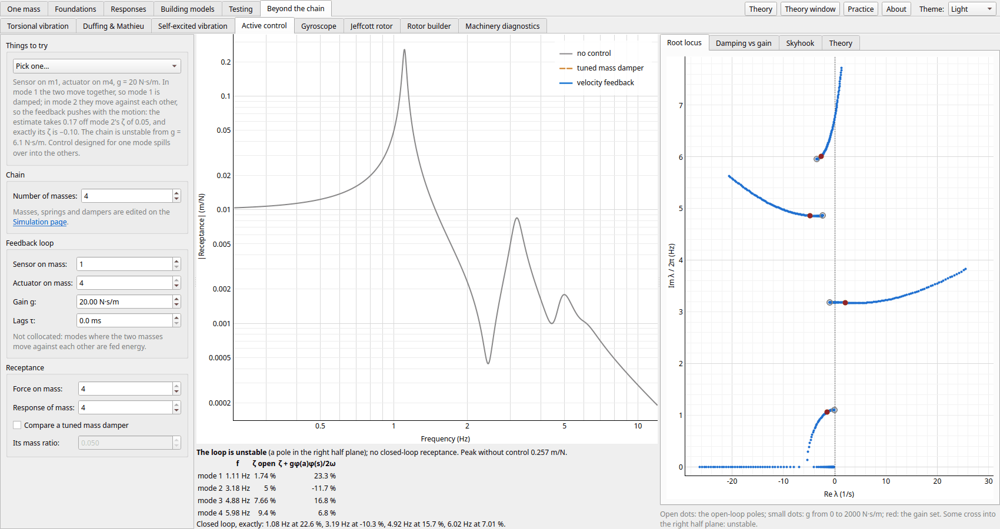
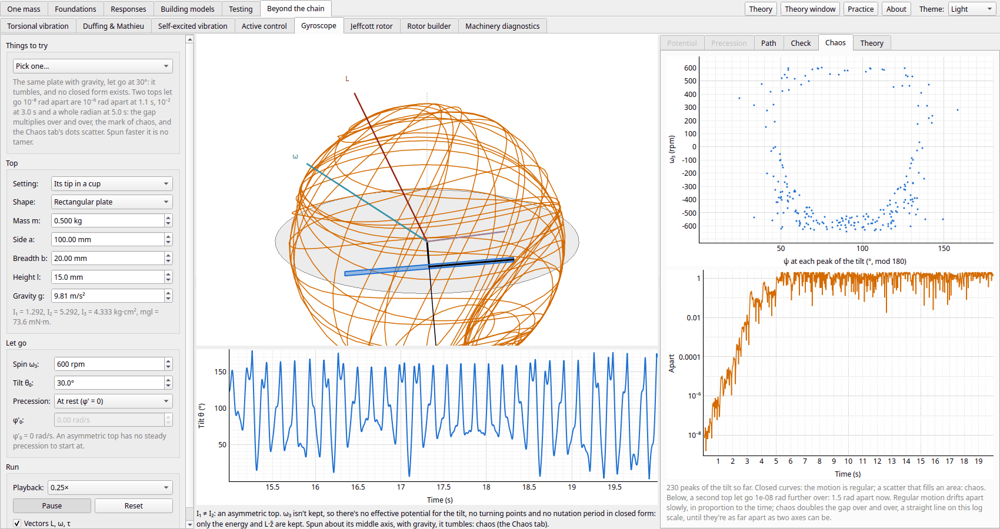
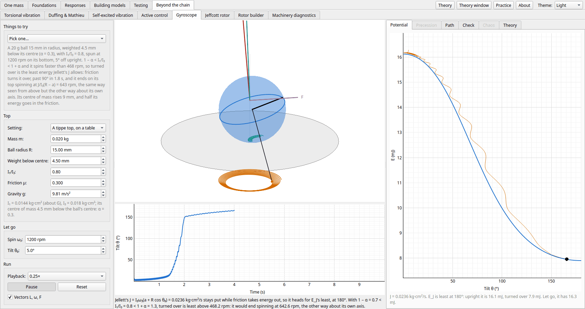
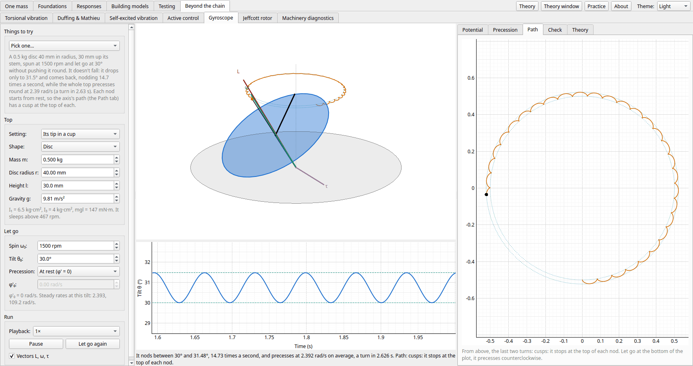
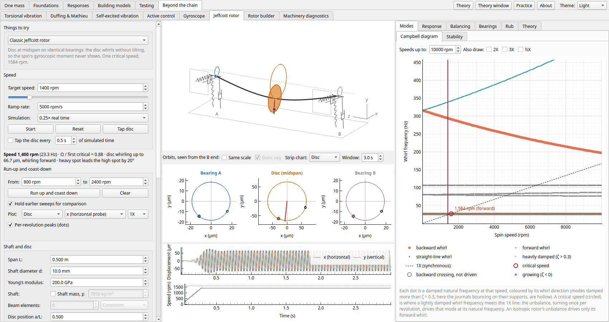
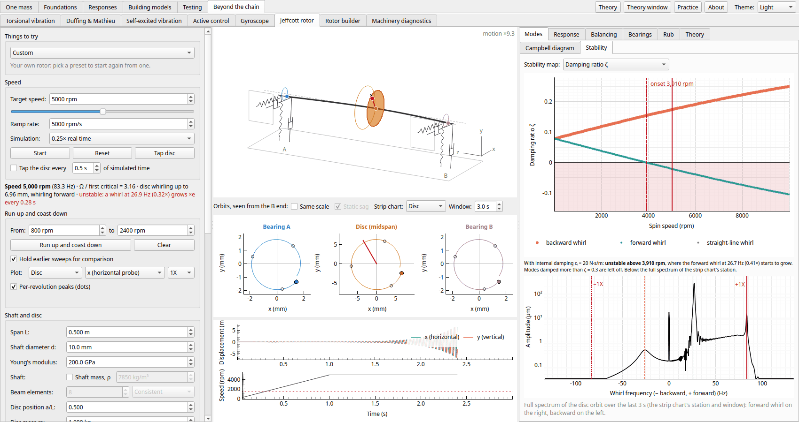

← [Testing](testing.md) · [Contents](../README.md#contents)

# Beyond the chain

The pages in the order the app's tabs take them.

- [Torsional vibration](#torsional-vibration): a drive train of discs, shafts and gears, and its start-up
- [Duffing & Mathieu](#duffing--mathieu): a nonlinear spring: jumps, chaos, and parametric resonance
- [Fluid–structure](#fluidstructure): a body in water: added mass of spheres, cylinders, tubes in pipes and plates, wet against dry
- [Self-excited vibration](#self-excited-vibration): negative damping and limit cycles: van der Pol, galloping, vortex-induced vibration and flutter
- [Active control](#active-control): velocity feedback, collocation, spillover and actuator lag, against a tuned mass damper
- [Gyroscope](#gyroscope): a spinning top: Euler's equations, steady precession, nutation and the sleeping top
- [Jeffcott rotor](#jeffcott-rotor): a spinning shaft: critical speeds, balancing, bearings, stability, rub
- [Machinery diagnostics](#machinery-diagnostics): order tracking under a run-up, gear-mesh sidebands, bearing defects by the envelope, and the cepstrum

## Torsional vibration

The **Torsional vibration** page takes a drive train apart: a line of discs (a motor, couplings,
gears, a fan, an engine's cranks, a generator) on shafts, each disc twisting against the next. Gear
meshes keep both gears' inertias and join them by the teeth's stiffness along the line of action, so
the far shaft turns at zin/zout times the near one's speed.

- **The train**: pick a disc or a link (or click it in the *Drive train* drawing) to change its
  inertia, stiffness or damping; make a shaft a gear mesh (teeth, base radius, mesh stiffness,
  transmission error) or a mesh a shaft; add and remove discs.
- **The interference diagram**: the natural frequencies, flat since nothing depends on the speed,
  against the orders that excite them: the train's own pulsating torque (an engine's firing
  orders, a compressor's, a misaligned coupling's 2×), each mesh's tooth-pass, and 1× and 2× of
  each shaft's speed. Where an order crosses a mode is a torsional critical speed; those within
  ±10 % of the running speed are filled red. Log scales show a mesh's kilohertz mode with the
  couplings'.
- **The steady response**: the dynamic torque in any shaft or mesh against the motor's speed,
  each order on its own and their sum, from (K − ω²M + iωC) Θ = T at each speed.
- **Mode shapes**: each mode's swing referred to the motor's shaft and which link it twists, and
  the n² reflection checked: the train referred to one shaft (inertias and stiffnesses × s²) has
  the same frequencies, while making the gears rigid keeps the lower modes and loses the mesh's.
- **The start-up** (centre, *Start-up* tab): a motor on the first disc runs the train up from rest
  against a load on the last that rises as its speed squared. An induction motor follows its
  speed–torque curve (Kloss's), with the line-frequency torque of switching it on direct on line;
  a synchronous motor starts on its cage, its poles adding a torque at twice the slip frequency
  that sweeps down from twice the line frequency through the modes below (drawn on the
  interference diagram too), and its field pulls it into step. The plots show a link's torque and
  the motor's speed as it plays, and each link's peak against what it carries running. Each step
  is the exact FOH update with the motor's and the load's torques solved at its end by Newton.
- **Presets**: a motor and fan on a coupling (two inertias, against the closed form), a geared
  compressor whose tooth-pass meets its mesh mode near the running speed, and a diesel generator
  set's firing orders against its crankshaft and flexible coupling. The fan starts on an induction
  motor and the compressor on a synchronous one.

![Torsional vibration page, the Geared compressor preset: a 10 kg·m² motor drives a 4:1 speed-up gearbox and a compressor through two couplings. On the log-log interference diagram the modes at 38.9 and 83.1 Hz (the couplings) and 2688 Hz (the mesh) cross the orders; the tooth-pass (120× the motor's speed) meets the mesh mode at 1344 rpm, 9.8 % below the 1490 rpm running speed, inside the ±10 % band; the dashed red curve is the synchronous motor's start-up pulsation, at twice the slip frequency, falling through the two coupling modes](images/torsional_compressor.png)

The geared compressor's couplings make two modes, at 38.9 and 83.1 Hz, and the teeth a third, the
two gears bouncing on the mesh at 2688 Hz. Made rigid, the n² reflection keeps the first two to
within 0.1 % but loses that one, and it is the one the tooth-pass meets at 1344 rpm, inside the
band round the 1490 rpm running speed.

Started on a synchronous motor, the same compressor's poles pulse at 100 Hz at rest, falling as it
runs up: they pass the 83.1 Hz mode at 254 rpm and the 38.9 Hz one at 916 rpm. The second rings the
low-speed coupling up to 11.3 kN·m, 4.5× what it carries running, before the field pulls the motor
into step at 1500 rpm.

## Duffing & Mathieu

The **Duffing & Mathieu** page drives one mass on a spring with a cubic term,
m x″ + c x′ + k(1 + μ cos φ) x + k3 x³ = F cos φ, that hardens (k3 > 0) or
softens (k3 < 0) as it stretches, and sweeps the drive's frequency slowly up and down.
The pump μ makes the stiffness itself pulse at that frequency (parametric excitation, the Mathieu
equation), and a small random force gives an unstable rest something to grow from.

- **Harmonic balance**: the first harmonic's steady amplitude against frequency, solid where
  stable and dashed where not, with the backbone (the free oscillation's frequency at each
  amplitude) and the linear spring's curve for comparison. Between the two folds there are three
  amplitudes, the middle one unstable, and the arrows mark the jumps from each fold.
- **Sweeps**: each drive cycle's measured first harmonic, coloured by the sweep's direction, on
  top of the curve, with the measured jump frequencies beside the folds'. Hold the frequency
  inside the band and *Start on a branch* puts the mass on the lower, middle or upper steady
  state.
- **Parametric resonance**: pumped, harmonic balance's half-harmonic response (rest, unstable
  inside the tongue, and a cubic spring's swinging branches, in closed form), with each cycle's
  measured ½X amplitude (both harmonics are taken over pairs of cycles, so a swing at Ω/2 doesn't
  leak into the first).
- **Ince–Strutt chart**: the pumped linear spring's growth rate against the pump's frequency and
  depth at the page's damping, from the Floquet multipliers of every cell at once; the tongues
  reach down to Ω = 2ωn/n, with harmonic balance's first tongue dashed over them.
  Click to pump there.
- **Phase plane**: the last few cycles' trajectory and, while the frequency is held, the
  Poincaré section (the state once per drive cycle).
- **Presets**: hardening and softening jumps, a linear spring for comparison, two stable states
  at one frequency, a softening spring thrown over its potential's hilltop (the page pauses when
  it escapes), parametric resonance on a linear spring (it grows until the page pauses) and on a
  hardening one (it settles), a parametric sweep with its jump, and Ueda's chaotic oscillator.
- **Notes**: harmonic balance, the backbone, the jump and its stability, sweep rate and
  critical slowing down, superharmonics, subharmonics and chaos, parametric excitation,
  Floquet theory and the Ince–Strutt chart.

A hardening spring's resonance leans toward higher frequencies, because a bigger swing is a
stiffer one. Sweeping up, the mass rides the upper branch past the linear resonance (3.18 Hz) to
its fold at 4.45 Hz, then drops to the lower branch. Sweeping down, it follows the lower branch to
the other fold, at 3.64 Hz, and jumps up. Near a fold the steady state is barely stable, so a
sweep overruns it before the mass leaves: here it drops at 4.62 Hz and jumps up at 3.56 Hz.

Pump the spring's stiffness instead of pushing the mass and rest itself turns unstable near twice
the natural frequency: the mass swings at half the pump's frequency. On a linear spring the swing
grows for ever (as e0.05ωnt with μ = 0.3 and ζ = 2.5 %, which the
simulation and the Floquet multipliers agree on), and damping needs a pump deeper than 4ζ to
start it. A hardening spring's swing detunes itself out of the tongue and settles, which makes a
jump of its own: sweeping down from rest, nothing happens until rest turns unstable at the
tongue's upper edge, and then the swing leaps up to a branch that the sweep back up rides far past
the tongue.

## Fluid–structure

What water does to a vibrating body. A body accelerating in a fluid has to push some of the fluid about,
and that flow's kinetic energy makes it behave as if it were heavier: its **added mass**. In open fluid a
sphere carries half the fluid it displaces and a cylinder all of it; the centre shows the potential flow
round the body, and how fast it falls off with distance. Inside a pipe, the fluid has to squeeze through
the gap, and the added mass grows without bound as the gap closes. The fluid adds no stiffness, so on its
springs the body's frequency falls by √(m/(m + ma)), set by the body's density against the
fluid's.

The *Plate* tab gives each mode of a baffled plate its own added mass, from the fluid's
pressure for each wavenumber in the mode's shape, and its AVMI factor β: a 3 mm steel panel in water
carries eight times its modal mass in its fundamental, and falls to a third of its frequency in air.
Higher modes carry less, as the fluid sloshes between their cells.

A liquid with a free surface has modes of its own. The *Sloshing* tab puts it in a rectangular tank
(the centre then shows the tank: the surface at its extremes and the flow as it passes level). The
modes' frequencies follow ω² = gk tanh(kh), so a shallow tank's first mode runs at √(gh)/2L and a deep
one's stops depending on depth. Under a sideways motion the tank behaves as a **spring–mass analogue**:
a rigid mass and a mass on a spring for each odd mode, the first by far the largest. The *Damper* tab
uses that first mode as a **tuned liquid damper** on a structure. The water's depth tunes it, screens
damp it, and the peak against depth shows where Den Hartog's tuning lies.

## Self-excited vibration

Motion that feeds itself, four ways: van der Pol's oscillator (negative damping that grows to a limit
cycle, and relaxation oscillations), galloping of a square section in a wind (Den Hartog's criterion and
the hysteresis between its branches), vortex-induced vibration with a wake oscillator (lock-in), and
two-mode flutter of a wing section, its root locus crossing into instability as the airspeed rises.

## Active control

Velocity feedback on the Simulation page's chain: the closed loop's poles exactly, against the light
feedback estimate; collocated control that damps every mode until too much gain pins the mass,
non-collocated control that spills over into a mode it destabilizes, an actuator's lag, a comparison
with a tuned mass damper of the same mass ratio, and skyhook isolation against a passive damper.

## Gyroscope

A spinning top with its tip held in a cup, from Euler's equations to the closed forms and a simulation.
Lagrange's top keeps the spin and the angular momentum about the vertical, so the tilt moves on its own
in an effective potential: steady precession at either root of I₁ cos θ φ'² − I₃ω₃φ' + mgl = 0, nutation
between the turning points (the roots of a cubic, the period an elliptic integral), and the cusps, loops
and waves the axis traces. Upright, the top sleeps above I₃ω₃ = 2√(I₁mgl). The 3D view steps the whole
rigid body (a quaternion and L, split into gravity's moment and the free top, each exact), which doesn't
mind the Euler angles' lock upright, and checks it against the closed forms. A square plate in place of
the disc moves exactly as a disc of radius s/√3 does: its moment is the same about every line across its
axis, so it is a symmetric top too. A rectangle isn't: with I₁ ≠ I₂ the spin isn't kept and every closed
form goes. Without gravity Euler–Poinsot's solution in Jacobi's elliptic functions remains, and spun about its
middle axis the plate flips over and back (the tennis-racket effect); with gravity there's none, and the
*Chaos* tab's Poincaré section and two tops let go 10⁻⁸ rad apart show the motion turn chaotic. Its last section links the
top's two precessions to the rotor's forward and backward whirl.

Out of the cup, a round tip slides on a table with Coulomb friction. Only Jellett's constant
J = L·(a e₃ + R ẑ) survives it, so the energy sinks onto the least energy that J allows at each tilt:
on a slippery table a disc on a round tip rises toward sleeping (until its tip starts to roll, at
sin θ = μI₃/maR; on a rough one it rolls round a circle instead), and a tippe top turns over onto its
top if 1 − α < I₁/I₃ < 1 + α, ending with its own spin reversed at the rate J gives.

## Jeffcott rotor

The **Jeffcott rotor** page spins a disc on a flexible shaft, between two bearings
or overhung past one, each bearing on springs and dampers to ground, horizontally and vertically (or in an oil film,
or floating in an active magnetic bearing). The disc has a mass,
polar and diametral moments of inertia, and a mass unbalance; the disc can also be skewed on
the shaft, the shaft bent (bowed), made stiffer about one axis than the other (asymmetric), and cracked. With the Jeffcott model's massless shaft the model has 8 DOFs: in each
plane, both journals, the disc, and the shaft's slope at the disc. Give the shaft its mass and
it becomes a beam finite element model, reduced to those 8 DOFs plus a few of the shaft's own
modes. It is stepped in state space with the same exact first-order-hold update as the chain, as
the speed ramps to a target.

- **Presets**: the classic Jeffcott rotor, an off-centre disc, anisotropic supports, an
  overhung rotor, a long shaft whose own mass matters, a two-pole rotor with an asymmetric shaft,
  a cracked shaft, oil swirl at λ = ½, and plain journal bearings, both going into oil whip, an
  upright rotor in oil whirl, an overhung rotor on magnetic bearings that its controller's lag
  makes unstable, and three rotors rubbing a stator ring: a partial rub with ½X, a full rub that
  flips into backward whirl, and a light rub that bows the shaft (the Newkirk effect). Each loads a rotor with a speed range to suit it and a note on what to look for.
- **Shaft mass**: tick it (and set the density) and the shaft gets its mass, its sections'
  rotary inertia and their gyroscopic moment. It is then 2 to 60 Euler–Bernoulli beam elements
  with consistent or lumped mass, reduced Craig–Bampton style to the stations and the shaft's
  modes with the stations held, up to 1 kHz. The Campbell diagram draws the massless model's
  branches dashed beside the real ones.
- **3D view**: the whirling shaft, the disc with its heavy spot, and the supports, drawn
  in perspective on an ordinary 2D plot, with no OpenGL. Drag to turn it.
- **Orbits** at bearing A, the disc, midspan and bearing B, seen from the B end, with
  once-per-revolution (keyphasor) marks. A line on the disc's orbit points at the heavy spot,
  so the phase lag can be read off it: 0° below the critical speed, 90° at it, 180° above.
- **Speed**: a target and a ramp rate, for run-ups and coast-downs through the criticals.
  Tapping the disc rings every mode, forward and backward; it can also tap again and again as
  it runs, like an impact test at speed.
- **Run-up and coast-down**: one button ramps to a starting speed, lets the start-up transient
  die away, then runs up to a second speed and back at the ramp rate. Once per revolution a
  keyphasor-triggered DFT takes the 1X vector (a tracking filter), along with the largest
  displacement over the revolution. Each leg becomes its own trace; earlier sweeps can be held
  to compare ramp rates, and a table gives each one's peak and the speed it came at against
  the steady state.
- **Bode and polar plots**: the steady-state 1X (or 2X) amplitude and phase lag against speed at
  either bearing, the disc or midspan, read by an x or a y probe or as the orbit's major axis,
  with the tracked sweeps over it and a marker at the current speed. On the polar plot the
  steady-state vector traces a near-circle through each critical speed.
- **Bent shaft and skewed disc**: two more sources that turn with the shaft. The bow, a set
  bend δb at the disc at an angle from the keyphasor mark, drives the rotor with a force
  kδb that does not grow with speed: the probes read it at slow roll, the polar curve
  starts from it, and well above the critical the disc settles on the bearings' axis. Against
  the unbalance it adds or cancels, depending on its angle. The skew τ is a couple unbalance,
  a moment (Id − Ip)τΩ² on the disc's tilt.
- **Gravity**: lay the rotor horizontal and it sags (378 µm at the disc with the defaults)
  and whirls about the sagged position, its orbits below the bearings' centre. *Static sag*
  switches the drawing between a DC-coupled probe's view and an AC-coupled one. The tracking,
  the spectrum and the phase always use the vibration about the sag, which is exactly the
  response without gravity: gravity alone makes no whirl, even on anisotropic supports (unless
  the shaft is asymmetric or cracked). Cross-coupled bearings and internal damping push the sag sideways.
- **Asymmetric shaft**: a shaft stiffer about one axis, EI(1 + Δ), than across it, EI(1 − Δ),
  as a two-pole generator's slots make it, its stiff axis at an angle from the keyphasor mark.
  Its stiffness turns with it, so it has two critical speeds and between them an unstable band
  where the whirl grows locked to 1X; laid horizontal, its weight drives a 2X whirl that peaks
  near half the critical speed (the gravity critical); and its 1X response depends on where the
  heavy spot sits from the stiff axis. The modes are exact Floquet modes (from axes turning with
  the shaft, or Hill's method on anisotropic supports), the steady states come by harmonic
  balance, and the time step splits off the turning stiffness as a mid-step kick.
- **Cracked shaft**: a transverse crack, its depth (up to half the shaft), its place along the
  shaft and its mouth's angle from the mark. Open, it is a hinge whose compliance comes from
  fracture mechanics (much larger to bending that opens it), condensed exactly onto the stations.
  Breathing, the shaft's weight opens and shuts it once a turn (weight dominance, as in Mayes and
  Davies' model), so its stiffness has 1X, 2X and 3X in it: the weight drives 2X and 3X whirls
  near a half and a third of the critical speed, and adds its own 1X to the unbalance's. The same
  machinery takes it, Hill's method and harmonic balance over every harmonic; the Bode and polar
  plots track 3X too.
- **Balancing, in one plane or two**: the field procedure by influence coefficients. Read the
  slow roll, the 1X vector as found, then with a trial weight, and the page works out the
  correction weight (grams at a radius and an angle from the keyphasor mark), puts it on and
  checks it. Each reading is a measurement on the running simulation: ramp, settle, average
  ten revolutions. *Mystery unbalance* hides the heavy spot to find. The response before and
  after against speed shows what one weight can and cannot do: subtract the slow roll and a
  bowed rotor is balanced at every speed, leaving only its runout; balance the raw reading and
  it is out of balance away from the balancing speed; a skewed disc's couple needs two planes.
  - **Two planes**: two probes, a trial run in each plane in turn, the 2 × 2 influence matrix
    with its condition number, and the two weights from its inverse. The planes are the disc's
    two faces (a set distance apart), which cancel its unbalance and couple at every speed, or
    anywhere on the shaft, which cancel the readings only at the balancing speed unless the
    planes are close to the unbalance. *Mystery unbalance* then hides a skew too.
- **Campbell diagram**: the damped natural frequencies against speed, coloured by whirl
  direction, with the 1X line and the critical speeds, and the onset of instability with the
  growing modes crossed. Drag the speed line to set the target. The speed range is adjustable
  (up to 60,000 rpm, and the speed controls and plots follow it), and 2X and ½X lines can be
  drawn too.
- **Overhung disc**: put the disc past a bearing (a/L above 1 or below 0) and it tilts as much as
  it moves, so the gyroscopic moment acts on the first mode in full and its forward and
  backward criticals separate strongly.
- **Stability**: cross-coupled bearing stiffness kxy = −kyx, constant or
  growing with speed as λcΩ (a fluid-film bearing's oil swirling at λ times the shaft's speed), or a
  journal bearing's film itself,
  and the shaft's internal (rotating) damping. The stability map draws each mode's damping ratio or
  log decrement against speed and marks the onset speed, where a forward mode's damping
  crosses zero (and, for an asymmetric shaft, where its unstable band ends). The asymmetry chart
  maps the instability against the shaft's asymmetry and the speed, an Ince–Strutt chart with one
  tongue between the two axes' critical speeds. Below it, the full spectrum of an orbit (the FFT of x + iy) separates forward
  from backward whirl, so past the onset the subsynchronous whirl shows as a growing line below
  +1X. The simulation pauses once the whirl reaches 2% of the span.
- **Waterfall and cascade**: full spectra of a station's orbit taken block by block as the rotor
  runs, stacked against the speed of the latest run-up or coast-down (a cascade) or against time
  (a waterfall), on a log or linear scale. The 1X line and the free whirl frequencies at each
  line's speed are marked under it. Tapped all through a run-up, the peaks trace the Campbell
  diagram's branches. The block length trades frequency resolution against the smear of 1X while
  the speed ramps.
- **Fluid-film bearing**: a plain journal bearing by short-bearing (Ocvirk) theory, from its
  diameter, length, clearance, oil viscosity and load: the Sommerfeld number, the journal's
  eccentricity and attitude angle, its locus in the clearance circle as the speed rises, and the
  eight linearized stiffness and damping coefficients against the speed or (dimensionless, as on a
  design chart) S(Lb/Db)², the modified Sommerfeld number, on which a short bearing depends alone,
  read at the rotor's speed now. Their skew part is exactly the
  λ = ½ swirl of the bearing table, and Lund's formula gives the speed at which a rigid rotor on the
  bearing goes into oil whirl. Choose *Oil-film journal bearings* under the bearing supports and the rotor runs in it at both ends,
  each under its share of the weight: their stiffness and damping change with the speed, the journals
  rest on the locus and rise along it (with *Static sag*), and oil whip comes from the bearing's own
  cross-coupling. Tick *Nonlinear film* beside it and the time response takes the films' whole force,
  in closed form, stepped by Newton's method beside the exact update: the journals stay inside their
  clearance through the critical, oil whirl settles to a limit cycle at half the speed, and oil whip
  grows on, the films holding the journals but not the shaft. Linearized, the page pauses when a
  journal reaches its clearance.
- **Magnetic bearing**: an active magnetic bearing, a pair of electromagnets on each axis under PID
  control. From the air gap, bias current, pole area and turns come the magnets' negative stiffness,
  the current gain and the load capacity; from the gains, the derivative's filter and the amplifier's
  bandwidth, the bearing's equivalent stiffness and damping against frequency, shaded where the
  damping is negative (the controller's lag), with the rotor's modes at the speed now drawn across
  them. Choose *Magnetic bearings* under the bearing supports and the rotor floats in it at both ends:
  the controllers' states join the rotor's (the exact update still steps them), the integral holds
  the journals at the centre under gravity, and a mode that moves out of the damped band, such as a
  forward tilting mode rising with the speed, grows. The page pauses when a journal lands on its
  backup bearing.
- **Rub**: a stator ring round the disc (a seal or a casing), with its clearance, its offset from the
  bearings' line, its mount's stiffness and damping, and the friction of the disc's rim on it. Once the
  whirl reaches it, the ring pushes the disc back and drags its rim against the slip, stepped by
  Newton's method beside the exact update. Brushing it on one side gives harmonics and, above twice
  the critical, ½X and ⅓X; held against it all round, enough friction flips the whirl backward, at the
  disc's frequency on the ring, until the rim rolls round it (dry whirl). The tab gives the gap at
  rest and the disc's frequency on the ring, and plots the ring's push; the ring is drawn round the
  disc in the 3D view and on its orbit. The ring is in the time response only. Give it a thermal gain
  and the rub's heat bows the shaft toward where it rubs, with a thermal lag (the Newkirk effect): a
  polar plot follows the disc's 1X vector and the bow, which spiral out below the critical speed and
  heal above it.
- **Equations & matrices**: M, C, G, K and the circulatory matrix H with the current numbers,
  the shaft's beam stiffness (condensed, or with mass reduced to the stations and the shaft's modes), the state matrix A(Ω), and the modes at the current
  speed. G is skew-symmetric: it sits beside C but does no work.
- **Theory**: whirl in complex coordinates, the classic case (the Jeffcott equation solved),
  heavy and high spot, the gyroscopic effect, the overhung
  rotor, forward and backward whirl, 2X and ½X excitations, anisotropic supports, run-ups through a critical speed (why a fast ramp
  peaks lower and later, beating, and the dimensionless ramp rate Ω'/ωc²), the bent
  shaft (slow-roll runout, why it is subtracted before balancing), the couple unbalance,
  gravity's static sag, the asymmetric shaft (its unstable band, the gravity critical and the
  unbalance angle), the breathing crack (its compliance, 2X and 3X, and its 1X),
  single- and two-plane balancing by influence coefficients (where the planes go, and why planes
  close together need large weights: the influence matrix's condition number),
  stability (why a skew stiffness feeds a forward whirl, the onset ωn(1 +
  ce/ci) of internal-damping whirl, oil whirl and whip at λΩ = ω), the
  fluid-film bearing (the film's sideways push, the locus, the coefficients and the threshold), active
  magnetic bearings (the negative stiffness, the PID's frequency-dependent stiffness and damping, and
  phase-lag instability), rotor–stator rub (partial rub and its sub-harmonics, the full rub's friction
  as a cross-coupling, dry whirl, and the Newkirk effect's spiral), waterfall and
  cascade plots (a measured Campbell diagram; block length against ramp rate), the shaft's own mass
  (beam elements, consistent against lumped mass, the reduction), and why the solution uses state
  space. Three figures, drawn in the current theme, show the heavy and high spots, a schematic
  Campbell diagram and a journal's attitude angle.

The default is the classic case: the disc at midspan on identical, isotropic supports, so its
translation and tilt are uncoupled, and the first critical speed is the textbook
√(keq/m), 1580 rpm (1584 rpm with the journals' mass). Moving the disc off
centre or making the bearings differ couples the tilt in, so the gyroscopic effect splits the
first mode. Different vertical and horizontal stiffness splits the critical speed in two,
with backward whirl between them.

A ramp through a critical speed gives the whirl no time to build up to its steady-state peak.
The faster the ramp, the lower the peak, and the further past the critical speed it comes: after
it on a run-up, before it on a coast-down. Whether a ramp counts as slow depends on
Ω'/ωc² against ζ². Once past the critical, the free vibration left over at the natural
frequency beats with the 1X response.

A bent shaft drives the rotor with a force that does not grow with speed. Turning slowly, the
probes read the bow itself, so the polar curve starts from the bow, not from the origin. Here
the bow points opposite the heavy spot: its response falls as the unbalance's grows, and they
cancel at one speed. That is why the slow-roll vector is subtracted before balancing.

Balancing a bowed rotor shows why the slow roll is subtracted first. Relative to its bent shape,
a bowed shaft sees an unbalance m·δb, so one weight removes every force the bow makes,
at every speed. What remains is the runout itself, which no weight removes and which makes no
force.

A skewed disc is a couple unbalance, which one weight can't cancel. Two weights on the disc's
faces make a force and a couple, the same form as the unbalance and the skew, so they cancel both
at every speed. Planes on the shaft would cancel the readings only at the balancing speed, and
planes close together need large weights, which errors in the readings swing.

Damping inside the shaft (ci) or cross-coupled stiffness in the bearings
(kxy) pushes a forward whirl along its orbit. Past the onset speed the whirl grows by
itself at the rotor's natural frequency, not at the speed, and no balancing removes it. With
ci = 20 N·s/m the default rotor is stable up to 3910 rpm; with no damping in the
supports the onset falls to the first critical speed itself.

An overhung disc tilts as much as it moves, so the gyroscopic moment acts on the first mode
itself: the forward whirl stiffens with speed and the backward one softens. The *Overhung rotor*
preset's first mode, 870 rpm at rest, becomes critical at 1284 rpm, 48% higher than without the
gyroscopic moment; only that forward crossing is driven by the unbalance. The *Oil swirl
λ = ½* preset turns the cross-coupling up with speed instead: the rotor goes
unstable at 3136 rpm, twice its first natural frequency, and above that whirls at that
frequency whatever the speed (oil whip). The *Journal bearings* preset gets the same from the
bearings themselves: plain journal bearings, far stiffer than the shaft, put the critical at
1845 rpm, close to the rigid-bearing 1854 rpm, and their film's cross-coupling drives oil whip from
3576 rpm, a little below twice that, at 30.5 Hz.

Stood upright, the same rotor's bearings carry no load, so it whirls at any speed. With the films'
whole force, below twice its first natural frequency the whirl is oil whirl, at half the speed: the
film stiffens toward the wall and holds the journals circling close to it, a limit cycle. Past about
3700 rpm the whirl locks at the natural frequency instead, oil whip, and grows on.

On magnetic bearings the stiffness and damping come from a controller, and they change with the
frequency. In the *Magnetic bearings* preset the amplifier's lag turns the damping negative above
739 Hz. The disc's forward tilting mode rises with the speed, and at 8894 rpm it crosses into that band
and goes unstable, exactly where the bearings' damping changes sign.

A rotor that reaches its seals rubs them. The *Partial rub* preset sags into the bottom of its seal
ring and, past about 4000 rpm, hits it every other turn: the orbit closes every two revolutions and
the spectrum shows ½X, the sub-harmonic that flags a rub. The *Full rub* preset's tighter ring holds
the disc all round, and its friction, pulling the rim backward, flips the whirl at 1545 rpm into
backward whirl at 227 Hz, the disc's frequency on the ring, rolling round it on an orbit of 7.3 mm.

The rub's heat bows the shaft toward where it rubs. Below the critical speed that pushes the high
spot further into the rub, and the *Newkirk effect* preset's 1X vector spirals out, turning against
the spin; above the critical the bow pulls the high spot away, and the same rub heals.

A cascade plot stacks the spectra taken through a run-up at their speeds. The unbalance makes a
ridge along 1X; a tap rings the free whirl frequencies, which move only as the gyroscopic effect
moves them. Tapped all the way up, the overhung rotor draws its own Campbell diagram: the
backward whirl falls and the forward one rises, and the 1X ridge grows where it crosses the
forward branch. On a full spectrum the backward branch lies on the other side of zero, so 1X
never meets it, which is why the backward crossing is not a critical speed.

Jeffcott's shaft has no mass, which is fine while it is light beside the disc: the default
rotor's steel shaft (0.31 kg under a 1 kg disc) only takes the critical speed from 1584 to 1458
rpm, about what adding 17/35 of its mass to the disc predicts. But a shaft also has bending modes of its own. In the
*Long shaft* preset it weighs more than the disc, and the massless model puts the first critical
35% too high (2146 rpm, not 1589) and misses the second, at 6582 rpm, altogether. With consistent
mass the second critical comes down from above as elements are added (7393, 6591 and 6582 rpm
with 2, 4 and 8); lumped mass has no such bound (8187, 6733 and 6620).

A two-pole generator's rotor is stiffer bending one way than the other, so its stiffness turns
with it. Laid horizontal, its own weight acts on a stiffness that changes twice per revolution
and drives a 2X whirl, largest where 2Ω meets the natural frequency: the *gravity critical*, at
half the critical speed. The *Two-pole rotor* preset's disc whirls 447 µm at 2X at 785 rpm,
more than its mean sag. Balancing does nothing to it.

Between its two critical speeds, one per axis, the asymmetric shaft is unstable: turning with the
shaft, the centrifugal force beats the soft axis's stiffness but not the stiff one's, and a whirl
grows locked to 1X. Undamped, the band runs exactly between the two critical speeds (a test
checks); damping narrows it, and below Δ = 0.123 on the default supports there is none. Above
it the rotor is stable again, unlike the instabilities from cross-coupling and internal damping.

A crack in a horizontal shaft breathes: the weight opens it as its mouth turns down and shuts it
half a turn later. Its stiffness then changes once a turn, with 2X and 3X in it, so the weight
drives a 2X whirl near half the critical speed, as the asymmetric shaft's does, and a 3X near a
third of it, which the asymmetric shaft has none of. The *Cracked shaft* preset's disc whirls
37.6 µm at 2X at 783 rpm and 18.6 µm at 3X at 522 rpm, and its 1X at the critical is 164 µm
against 54 µm uncracked. Held open, the crack is an asymmetric shaft: no 3X, and twice the 2X.

## Rotor builder

Build a rotor the way the Frame builder builds a frame, from parts: a shaft of sections (each a solid or
hollow tube of steel, aluminium or titanium, cut into beam elements), discs from a library (by material and
size) or by their mass and inertias, bearings (springs and dampers, cross-coupled or not and stiffer one way
than the other; a plain journal bearing's oil film; or an active magnetic bearing under PID control) and
seals (a direct stiffness and damping, and the cross-coupling λΩc of their swirling fluid). Click the side
view to cut a section or put a part on the shaft, drag a part along it, and edit the picked one on the
left. Every node has x, y and their slopes; each shaft element is a rotating Timoshenko beam (or
Euler–Bernoulli's, with the sections' rotary inertia), and every change assembles M, C(Ω), G and K(Ω) again:
the *Assembly* tab shows them at the speed with the picked part's share tinted, the *Element* tab its own
(an oil film's eight coefficients under its share of the rotor's weight, a magnet's negative stiffness). The
modes at the speed come from the state space, the magnets' controllers included: each one's frequency,
damping ratio and log decrement, and whether it whirls forward or backward, drawn in 3D on the *Whirl* tab
with every node's orbit. The trials compare it with Euler's pinned and free beams and with the Jeffcott
rotor page's model, split a disc's modes by its spin, and part them on anisotropic bearings.

Then sweep the speed. The *Campbell* tab plots every branch against it, forward and backward, and marks the
critical speeds where one meets 1X, each with its amplification factor 1/2ζ (those under 2.5 hollow:
critically damped) and the running speed's separation margin. Give the discs an unbalance (a library disc
has 10 µm of its mass) and the *Unbalance* tab plots any node's steady orbit and its lag behind the heavy spot
through the criticals, exactly in the full model: the overhung fan's peaks at 1003 µm at its forward critical
and barely shows its backward ones. The rotor can whirl in that response instead of a mode. The *Stability*
tab plots each branch's log decrement against API 684's 0.1, and finds where the rotor first grows by itself:
an oil film's whip at 5466 rpm, a seal's swirl at 6845, the shaft's internal damping at 1.44 ×
its critical. The sweeps work in a Ritz basis of the rotor's lowest modes, a millisecond a speed.

## Machinery diagnostics

A gearbox's casing acceleration, synthesized: the shaft's 1X and 2X, the pinion's mesh, a gear fault
(an eccentric pinion or a cracked tooth) and a rolling bearing's defect (outer race, inner race or ball)
ringing a casing resonance. A run-up's spectrum against frequency and against order (resampled at
equal angles), each order tracked against its steady state; the sidebands round the mesh; envelope
analysis, which finds the bearing's strikes the plain spectrum hides; and the cepstrum, which gathers
a family of sidebands into one peak.

---

← [Testing](testing.md) · [Contents](../README.md#contents)
