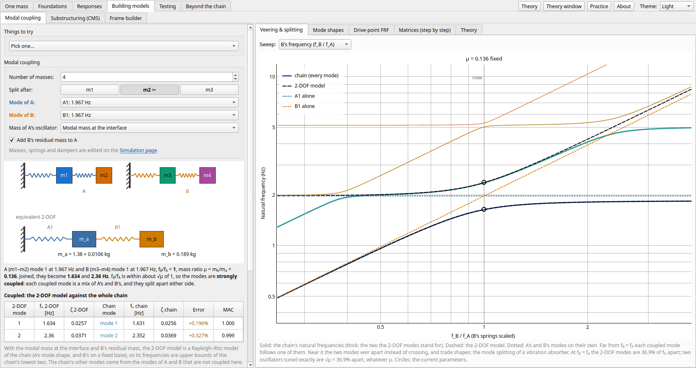
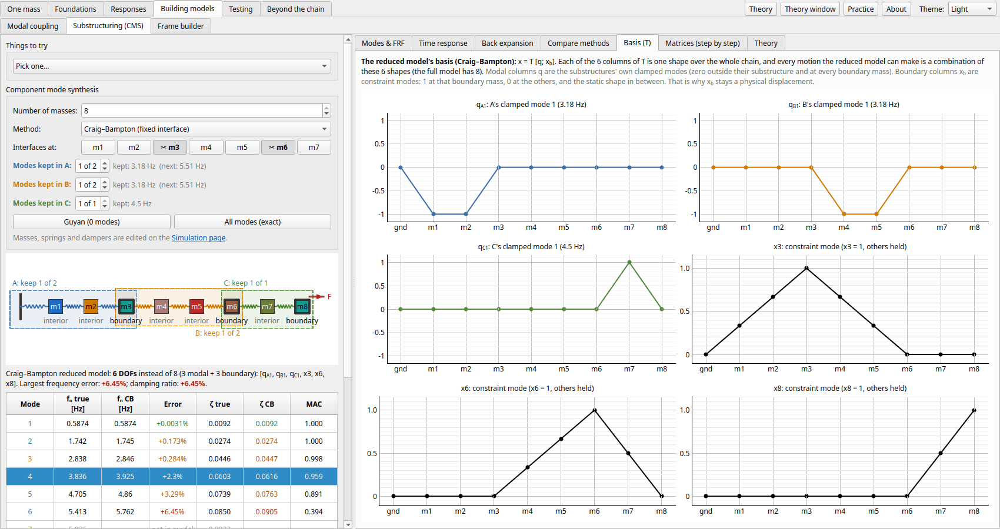
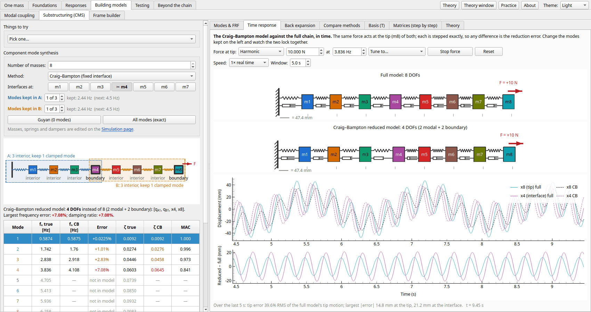
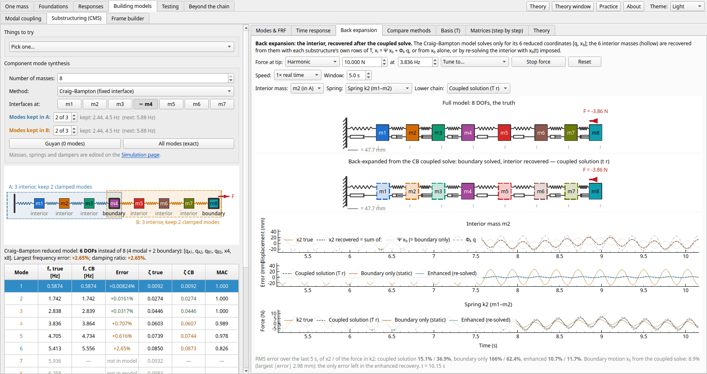
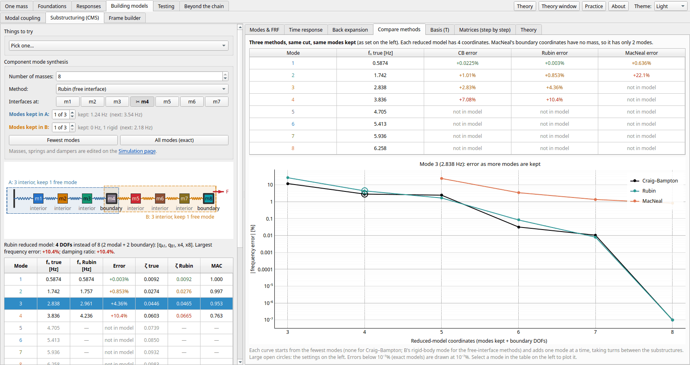
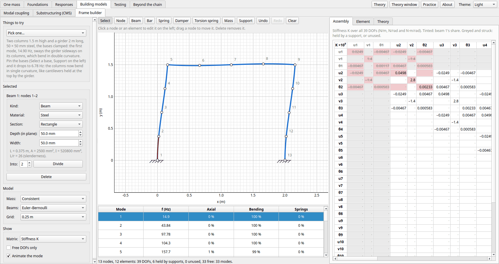
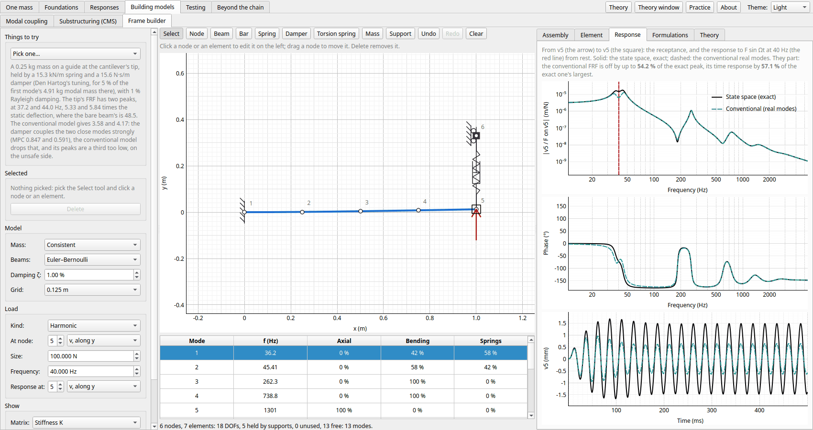

← [Responses](responses.md) · [Contents](../README.md#contents) · [Testing](testing.md) →

# Building models

The pages in the order the app's tabs take them.

- [Modal coupling](#modal-coupling): two parts joined, one mode each: when their modes split
- [Substructuring (CMS)](#substructuring-component-mode-synthesis): a chain reduced to a few modes per part, and back
- [Frame builder](#frame-builder): build a frame or truss from beams, bars and springs: assembly, supports, modes

## Modal coupling

Two systems that are each fine on their own can misbehave once joined: when a mode of one is
close in frequency to a mode of the other, and the masses are not too different, the two
modes **split**. This is how a vibration absorber works, but it usually happens when nobody
meant it to. The **Modal coupling** page shows it on the chain. *Split after* cuts the chain into
**A** (the masses up to the cut, on the ground as before) and **B** (the rest, with the spring
and damper that joined it to A tied to the ground instead). Each is solved on its own, one mode of
each is replaced by a single-DOF oscillator that keeps its frequency and modal damping ratio, and
the two oscillators are joined again, B's on A's:

```
ground ──[k_a,c_a]── m_a ──[k_b,c_b]── m_b
```

The oscillator masses are the masses the joint feels:

- **B**: its **effective mass** along x, Γ² with Γ = φ<sup>T</sup>M**1** (φ mass-normalized),
  since B is joined at its base. The rest of B's mass (its other modes) moves rigidly with the
  base, so it is added to m<sub>a</sub> as B's **residual mass**.
- **A**: its **modal mass at the interface**, 1/φ<sub>tip</sub>², since A is joined at its tip.
  A's effective mass can be chosen instead, to see how much worse it does.

With these choices the 2-DOF model is a Rayleigh–Ritz model of the chain (B's part is
Craig–Bampton with one mode kept; see the next section), so its two frequencies are upper bounds of the chain's lowest
two. The page compares them with the chain's (frequency, exact damping ratio, MAC) and draws the
2-DOF modes on the chain. Any mode of A can be coupled with any mode of B. The *Drive-point FRF*
tab compares the receptance of the chain and of the 2-DOF model at the interface (A's tip) or at
the free end (B's tip, where a force is usually applied), with A alone (B removed) and B alone
(A removed, its base on the ground) for reference. *Matrices (step by step)* works both masses through with the current
numbers: the generalized mass and mass normalization (why 1/φ<sub>tip</sub>² is a mass), the
influence vector **r** solved from a unit base motion, each mode projected on how the joint loads it
(a point load **e**<sub>tip</sub> on A, the inertia M**r** on B), the 2-DOF matrices, and the
Rayleigh–Ritz check, with a notation table.

The **Veering & splitting** tab sweeps B's frequency (or the mass ratio μ = m<sub>b</sub>/m<sub>a</sub>)
and plots the chain's and the 2-DOF model's frequencies. Near f<sub>B</sub> = f<sub>A</sub> the two
modes veer apart instead of crossing; two oscillators tuned exactly end up √μ·f<sub>a</sub> apart,
whatever μ.



## Substructuring (component mode synthesis)

The *Substructuring* page starts with the whole chain as one substructure, whose only
boundary DOF is the tip: the single-component case, to learn the fundamentals on (Guyan then
reduces it to that one DOF, the largest error the page can show). Click masses under
*Interfaces at* to cut the chain there into substructures A (grounded), B, C, ... up to the
free end, and click them again to remove the cuts. The boundary (master) DOFs are the interfaces and the last mass, which is where
the force is applied, so the loaded DOF stays physical. Each substructure keeps its own
chosen number of modes plus one static shape per boundary DOF, and the reduced
substructures are assembled on the shared interface DOFs. The
*Method* selector chooses the component modes:

- **Craig–Bampton** (fixed interface): modes with the boundary held, plus constraint modes.
- **Rubin** (free interface): modes with the boundary free, as a modal test would measure
  them, plus the *residual flexibility* of the discarded modes. B floats on its own, so its
  rigid-body mode is always kept.
- **MacNeal** (free interface): as Rubin, but the residual flexibility is massless, so the
  boundary DOFs carry no inertia and the model has only as many modes as modes kept.

Everything on the page follows the selector:

- **Comparison table**: true vs reduced natural frequencies, the error (never negative for
  Craig–Bampton and Rubin, whose frequencies are upper bounds), and the MAC of the recovered
  shape.
- **Substructures on their own**: each substructure's own modes (natural frequency and
  exact damping ratio with its boundary held, or free), whether each is kept, and the
  coupled mode it becomes (largest share of that mode's energy).
- **Component shape overlay**: click a row of that table to draw the clamped component
  shape over the coupled mode it becomes.
- **Basis (T)**: every column of T drawn as a shape along the chain, the set of shapes every
  reduced-model motion is built from.
- **Modes & FRF**: the selected mode shape, true vs reduced, and the tip and interface
  receptance of both models for the force at the tip.
- **Time response**: the reduced model simulated beside the full one, with the same exact
  stepper and the same force at the tip (a step, a harmonic, or a pulse). The two chains are
  animated one above the other at the same scale, over time histories of the tip and interface
  and of their difference. All three methods are exact statically, so the error is in the
  vibration: small after a step, large when driven at a mode the reduced model has shifted
  (below). *Tune to…* offers the true and the reduced natural frequencies.
- **Back expansion**: the coupled (reduced) model solves only for [q, x<sub>b</sub>]; this tab
  recovers the interior masses from them afterwards, as a system analyst does with a
  substructure delivered as reduced matrices. Three recoveries of one interior mass and one
  spring force are compared with the truth: from the coupled solution with the reduced
  model's own T (split into the part the boundary drags along and the part the kept modes
  add), from the boundary motion alone (static), and *enhanced*, by re-solving the
  substructure's interior with the coupled model's boundary motion imposed. The lower chain
  draws the recovered masses hollow.
- **Compare methods**: the same cut reduced by all three methods, with the frequency error of
  every mode, and how the selected mode's error falls as modes are added, one at a time.
- **Matrices (step by step)**: every stage with the current numbers: the full K and M,
  each substructure's partitioned matrices, its component modes (kept and discarded), the
  constraint modes Ψ or the residual flexibility G<sub>d</sub>, the transformation T, the
  reduced matrices, the assembled reduced model, and each substructure's recovery (OTM) and
  loads (LTM) transformation matrices.
- **Theory**: what a basis is (with a 2-mass worked example) and why Craig–Bampton chooses
  its shapes, original vs substructured formulation side by side, Hurty vs Craig–Bampton,
  Guyan reduction as the zero-mode case, why free-interface modes need residual flexibility,
  MacNeal vs Rubin, the three methods side by side, back expansion (data recovery), one-click "Things to try"
  walkthrough, and a notation
  table.
- **Presets**: *Guyan (0 modes)* (*Fewest modes* for the free-interface methods) and *All
  modes*.

With more cuts each substructure is smaller and has fewer modes to keep, but every interface
stays in the model as a physical DOF. For 8 masses and a 6-DOF model, one cut with 2 modes
each gets modes 1 to 4 within 0.7%; two cuts with 1 mode each only within 2.3%:



For each substructure, partitioned into interior $i$ and boundary $b$ DOFs,

$$\begin{bmatrix}x_i\\ x_b\end{bmatrix} = \underbrace{\begin{bmatrix}\Phi_k & \Psi\\ 0 & I\end{bmatrix}}_{T}\begin{bmatrix}q\\ x_b\end{bmatrix},
\qquad \Psi = -K_{ii}^{-1}K_{ib},\qquad \hat M = T^TMT,\ \hat K = T^TKT$$

where $\Phi_k$ are the $k$ lowest mass-normalized modes of $K_{ii}\phi = \omega^2 M_{ii}\phi$.
$\hat K$ is block diagonal, $\mathrm{diag}(\omega_k^2)$ and $K_{bb} - K_{bi}K_{ii}^{-1}K_{ib}$, while
$\hat M$ couples $q$ to $x_b$.

The free-interface methods use the lowest $k$ modes $\Phi_k$ of the whole substructure,
$K\phi = \omega^2 M\phi$, and keep the static response of the discarded ones through the
residual flexibility $G_d = \Phi_d\Lambda_d^{-1}\Phi_d^T$. Writing
$x = \Phi_k q + G_d E_b f_b$ and eliminating the interface forces $f_b$ with the boundary
rows gives a transformation of the same shape as Craig–Bampton's:

$$T = \begin{bmatrix}\Phi_{ik} - R\,\Phi_{bk} & R\\ 0 & I\end{bmatrix},\qquad R = G_{ib}G_{bb}^{-1}$$

Rubin's method projects with it, $\hat M = T^TMT$; MacNeal's drops the residual mass,
$\hat M = \mathrm{diag}(I, 0)$. Both have $\hat K = T^TKT$, which now couples $q$ to $x_b$.



After the coupled solve each substructure recovers its interior from its own rows of T,
$x_i = \Psi x_b + \Phi_k q$ (Craig–Bampton). The *enhanced* recovery instead solves
$M_{ii}\ddot x_i + C_{ii}\dot x_i + K_{ii}x_i = -K_{ib}x_b - C_{ib}\dot x_b$ with the coupled
model's $x_b(t)$, so it keeps every interior mode and its only error is the error in $x_b$:





## Frame builder

Build a plane frame or truss on a grid: click to place nodes, click two nodes to join them with a beam (it
bends and stretches), a bar (it only stretches) or a spring or damper (or anchor one to the ground), add
point masses and torsion springs, and give nodes supports (pinned, rollers, clamped, guided). Each node has
u, v and θ. Every change assembles the global M, C and K again: the *Assembly* tab shows the whole matrix,
with the picked element's share Tᵀk'T tinted and the DOFs a support holds or no element touches (a truss
node's turn) struck out; the *Element* tab shows its k' or m' in its own axes, its T, and the global DOFs
it lands on. Massless DOFs (a lumped beam's turns) are condensed out exactly, mechanisms show as modes at
0 Hz, and each mode swings on the frame with the beams bending along their cubics, its strain energy split
between stretching, bending and the springs. Consistent or lumped mass, and Euler–Bernoulli or Timoshenko
beams; the trials compare the mesh with Euler's cantilever and the Beams & plates page's thick beam.



Then load it: a harmonic force, an impulse or a step on any DOF (a moment on a turn), with Rayleigh damping
(ζ at the first two modes) and the dampers you've placed. The *Response* tab plots the receptance to any DOF
and the response from rest, worked out two ways: the **conventional** model (the undamped modes, each a
single oscillator with ζ = φᵀCφ/2ω, ΦᵀCΦ's off-diagonal terms dropped) and the **state space**
(A = [0 I; −M⁻¹K −M⁻¹C], nothing dropped), both stepped exactly, the load generated by states of its own. With
proportional damping they agree; a damper makes them part. The *Formulations* tab sets each undamped mode
beside the state space's, its f, ζ and MPC, with the complex shape in the complex plane, and the frame can
swing in it, its nodes out of step. A tuned mass damper is the worst case: its peaks come out a third too
low conventionally.



---

← [Responses](responses.md) · [Contents](../README.md#contents) · [Testing](testing.md) →
