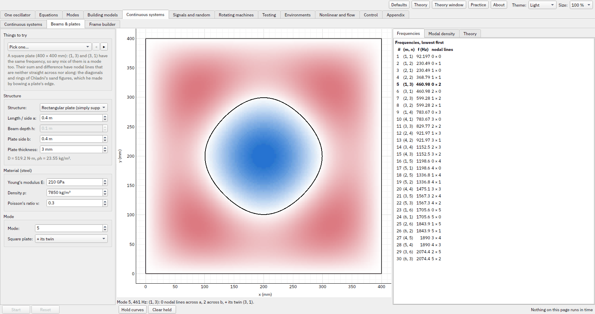
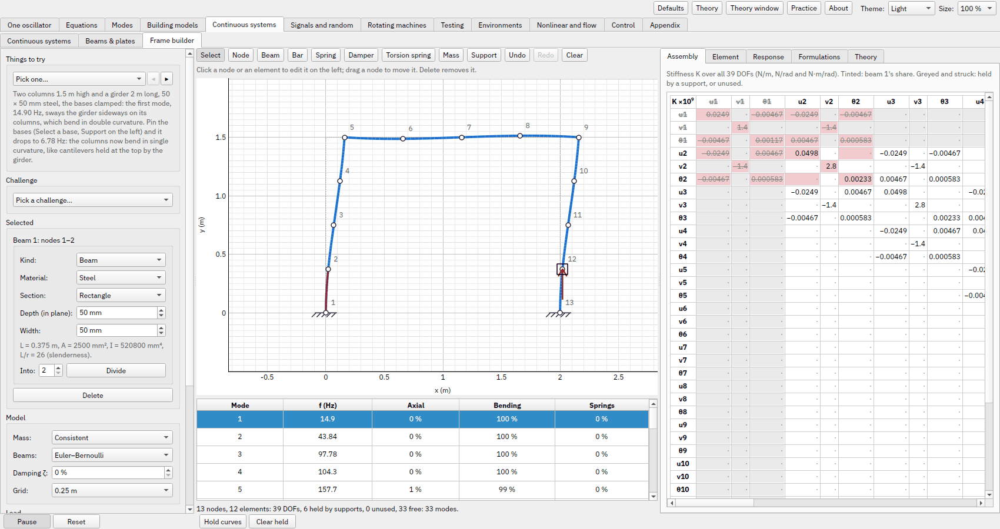
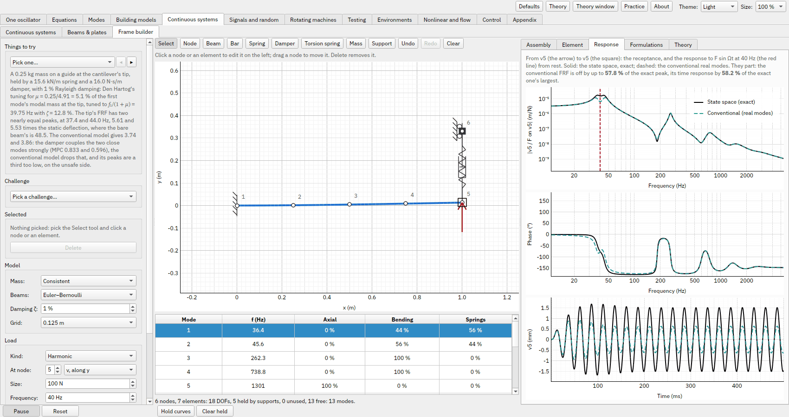

← [Building models](building-models.md) · [Contents](../README.md#contents) · [Signals and random](signals-and-random.md) →

# Continuous systems

Continuous structures (a string, a bar, a beam, a plate, a frame) cut into elements: which of their modes to trust.

The pages in the order the app's tabs take them.

- [Continuous systems](#continuous-systems): a string, a bar or a beam cut into a chain: which of its modes to trust
- [Beams & plates](#beams--plates): Timoshenko's thick beam, a plate's modes and nodal lines, and modal density
- [Frame builder](#frame-builder): build a frame or truss from beams, bars and springs: assembly, supports, modes

## Continuous systems

The **Continuous systems** page goes the other way from the chain: a string, a bar or a beam is a
continuum with infinitely many modes, and the chain is what you get by cutting it into N equal
elements. Its waves say which of the chain's modes to trust.

- **The medium**: a string (tension, mass per length), a bar (axial waves) or an Euler–Bernoulli
  beam (bending), its length, material and section, and each end fixed or free (a beam's clamped,
  pinned or free). The exact modes come in closed form, a beam's from its ends' frequency equation.
- **The mesh**: 1 to 200 elements, linear for the string and bar and Hermite cubics for the beam,
  with three ways to share out the mass, shown together: *lumped* (half to each node: beads on a
  string, or the first page's chain), *consistent* (from the stiffness's own shape functions, an
  upper bound on every frequency) and *mixed* (their average).
- **Dispersion**: frequency against wavenumber, the continuum's (ω = cκ, or aκ² for a beam) with each
  mesh's, which bends away and stops at κ = π/h, two elements a wavelength. The mesh's modes are dots
  on it: a string's or bar's lie exactly on the mesh's curve, since its modes are the endless mesh's
  waves sampled at the nodes. A beam's consistent mass adds a second branch, the slopes against the
  deflections, drawn past π/h, where its extra modes land.
- **Errors**: each mode's frequency error against its number, and the chosen mode's against the
  number of elements on log scales, with the slope: N−2 lumped or consistent, N−4
  mixed for a string or bar; N−2 lumped and N−4 consistent for a beam.
- **Mode shape and frequencies**: the chosen mode, exact and on each mesh (the nodes and the
  elements' own interpolation between them), and a table of every mode's frequency and error.
- **Waves** (centre, *Waves* tab): a pulse runs along the continuum and the mesh side by side,
  travelling right or released at rest. The continuum's is exact: a string's or bar's two
  d'Alembert waves carried along, scattered at the ends in closed form, or a beam's exact modes
  summed. The mesh is stepped by its exact matrix exponential. On it the pulse sheds ripples
  (behind it with lumped mass, ahead with consistent), since its short waves travel at the wrong
  speed and none shorter than two elements travels at all. The pulse comes back from a fixed end
  upside down and from a free end upright. A *dashpot* on the far end reflects
  (1 − r)/(1 + r) of the wave, r its damping over the impedance Z (√(Tμ) or ρcA): matched (r = 1)
  it absorbs the continuum's pulse, but not the mesh's short waves. A *step* in the string's mass or
  the bar's section reflects (Z₁ − Z₂)/(Z₁ + Z₂) of a wave and passes 2Z₁/(Z₁ + Z₂). The mesh's
  energy is shown as it goes.
- **Presets**: a guitar string as beads, a steel bar held at one end, a steel ruler over a desk's
  edge, a vibraphone bar (free–free), and a pinned beam whose modes lie on the mesh's curve; and
  four wave presets: a pulse on 40 beads, a matched end, a light string tied to a heavy one, and a
  bending pulse on a beam.

![Continuous systems page, the Guitar string preset: on the dispersion plot the continuum's straight line ω = cκ (c = 106.8 m/s) and three 12-element meshes' curves bending away from it to the cut-off at κ = π/h = 58.2 rad/m, lumped low (topping out at 630 Hz where the continuum is at 989 Hz), consistent high (1090 Hz) and mixed close to the line, each mesh's modes dots on its curve; mode 6, four elements a wavelength, is marked: exact 494.4 Hz, lumped 445.2 Hz (−9.97 %), consistent 545.2 Hz (+10.3 %), mixed 487.6 Hz (−1.38 %). On the right its shape: each mesh's nodes are exactly on the sine](images/continuum_string.png)

A low E string as 12 beads: the 6th harmonic, four beads a wavelength, is 10 % flat, though its
shape at the beads is the sine's exactly (MAC 1). The frequency error is all in the dispersion: the
beaded string is slower for short waves, and carries none shorter than two beads.

![Continuous systems page, the Steel ruler preset's Errors tab: the frequency error of each of 8 Hermite elements' modes against the mode number, lumped falling to −24 %, consistent within 1.2 % for the first six, mixed between them, and above mode 8 the consistent and mixed meshes' slope modes far off; below, mode 3's error against the number of elements on log scales, falling as N⁻² lumped and mixed and N⁻⁴ consistent; on the right mode 3's shape, the meshes' nodes on the exact one (MAC 0.992 lumped, 1.000 consistent)](images/continuum_beam.png)

A clamped steel ruler's third mode: eight elements are already within 0.06 % with consistent
masses, which converge as N−4; lumped masses, leaving the slopes without inertia, only
as N−2.

Halfway along this string the mass per length is four times as much: twice the impedance and half the
speed. A third of the pulse comes back upside down and two thirds go on, squeezed to half the length.
On 100 elements the squeezed pulse is only five elements wide, and the mesh carries 0.49 of it where
the string carries 0.67, shedding ripples behind.

## Beams & plates

Beyond the Continuous systems page's slender beam: a simply supported beam by Euler–Bernoulli, Rayleigh
(rotary inertia), shear alone and Timoshenko (both, with its thickness-shear branch), and their wave
speeds; a simply supported rectangular plate's and a clamped circular plate's modes and nodal lines
(a square plate's twin modes mixed into Chladni's figures); and the modes per hertz, ∝ √f for a beam and
constant for a plate.

## Frame builder

Build a plane frame or truss on a grid: click to place nodes, click two nodes to join them with a beam (it
bends and stretches), a bar (it only stretches) or a spring or damper (or anchor one to the ground), add
point masses and torsion springs, and give nodes supports (pinned, rollers, clamped, guided). Each node has
u, v and θ. Every change assembles the global M, C and K again: the *Assembly* tab shows the whole matrix,
with the picked element's share Tᵀk'T tinted and the DOFs a support holds or no element touches (a truss
node's turn) struck out; the *Element* tab shows its k' or m' in its own axes, its T, and the global DOFs
it lands on. Massless DOFs (a lumped beam's turns) are condensed out exactly, mechanisms show as modes at
0 Hz, and each mode swings on the frame with the beams bending along their cubics, its strain energy split
between stretching, bending and the springs. Consistent or lumped mass, and Euler–Bernoulli or Timoshenko
beams; the trials compare the mesh with Euler's cantilever and the Beams & plates page's thick beam.

Then load it: a harmonic force, an impulse or a step on any DOF (a moment on a turn), with Rayleigh damping
(ζ at the first two modes) and the dampers you've placed. The *Response* tab plots the receptance to any DOF
and the response from rest, worked out two ways: the **conventional** model (the undamped modes, each a
single oscillator with ζ = φᵀCφ/2ω, ΦᵀCΦ's off-diagonal terms dropped) and the **state space**
(A = [0 I; −M⁻¹K −M⁻¹C], nothing dropped), both stepped exactly, the load generated by states of its own. With
proportional damping they agree; a damper makes them part. The *Formulations* tab sets each undamped mode
beside the state space's, its f, ζ and MPC, with the complex shape in the complex plane, and the frame can
swing in it, its nodes out of step. A tuned mass damper is the worst case: its peaks come out a third too
low conventionally.

---

← [Building models](building-models.md) · [Contents](../README.md#contents) · [Signals and random](signals-and-random.md) →
