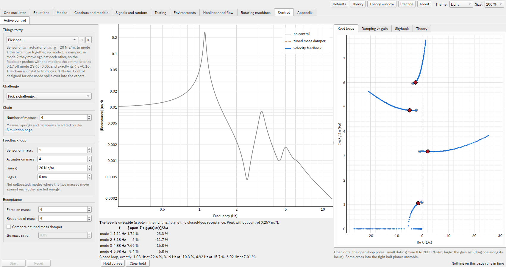

← [Rotating machines](rotating-machines.md) · [Contents](../README.md#contents) · [Appendix](appendix.md) →

# Control

Controlling vibration with feedback.

The pages in the order the app's tabs take them.

- [Active control](#active-control): velocity feedback, collocation, spillover and actuator lag, against a tuned mass damper

## Active control

Velocity feedback on the Simulation page's chain: the closed loop's poles exactly, against the light
feedback estimate; collocated control that damps every mode until too much gain pins the mass,
non-collocated control that spills over into a mode it destabilizes, an actuator's lag, a comparison
with a tuned mass damper of the same mass ratio, and skyhook isolation against a passive damper. On the
root locus, drag a pole along its path and the gain follows.

---

← [Rotating machines](rotating-machines.md) · [Contents](../README.md#contents) · [Appendix](appendix.md) →
