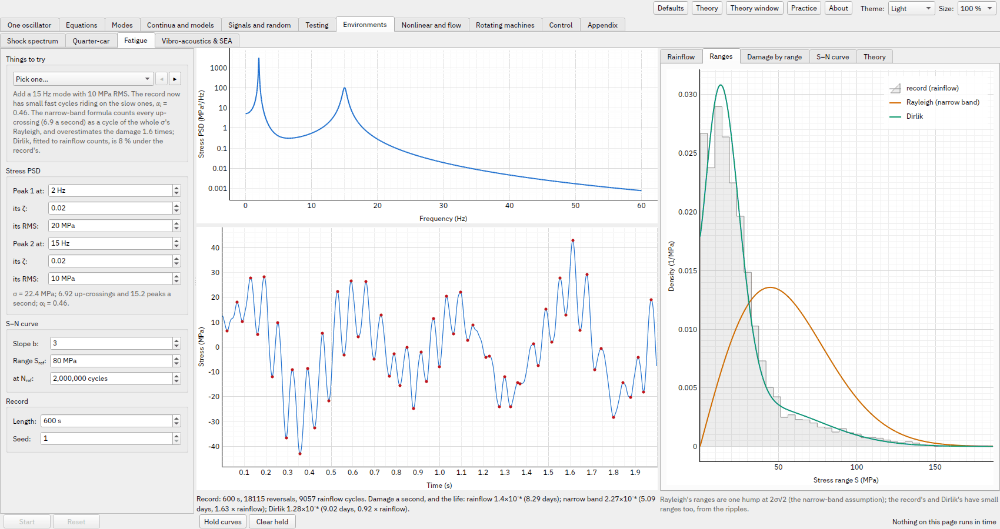

← [Testing](testing.md) · [Contents](../README.md#contents) · [Nonlinear and flow](nonlinear-and-flow.md) →

# Environments

What a structure meets in service: shocks, roads, fatigue and sound.

The pages in the order the app's tabs take them.

- [Shock spectrum](#shock-spectrum): a short pulse on a bank of oscillators, and on the chain
- [Quarter-car](#quarter-car): a suspension on an ISO 8608 road: comfort, grip and travel from the road's PSD
- [Fatigue](#fatigue): a random stress counted by rainflow: S–N curves, Miner's rule, narrow-band and Dirlik estimates
- [Vibro-acoustics & SEA](#vibro-acoustics--sea): a panel's sound: radiation efficiency, coincidence, the mass law, and energy flow between parts

## Shock spectrum

The **Shock spectrum** page puts a short pulse on the base of a bank of single-degree-of-freedom
oscillators, Q = 10 by custom, and plots each one's largest absolute acceleration against its natural
frequency: the shock response spectrum (SRS), what a component with that natural frequency mounted on
the base would see. The pulse's duration is set from the chain on the Simulation page, and the chain's
modes are marked on the spectrum.

- **The pulses**: the classical ones (half-sine, haversine, terminal- and initial-peak sawtooth,
  trapezoid, square), and two measured records with noise and an offset if you like. One is the
  acceleration of a mass on the chain with its base given a half-sine, the shock a component mounted
  there sees. The other is a pyrotechnic-like transient, a burst of damped sines that ends at rest.
  And two records synthesized to a target spectrum (a plateau above a knee, rising 6 dB an octave below
  it, at Q = 10), the way a shaker test is set up: damped sines, which leave the table moving, or
  Smallwood's wavelets, which start and end at rest. Their amplitudes are scaled round by round until
  the spectrum meets the target.
- **The spectrum**: the maximax, and on request the primary (while the pulse lasts) and residual (after
  it) spectra, and the positive and negative ones. Dashed lines mark its two asymptotes: the pulse's
  peak, which stiff oscillators follow, and 2π f Δv, the ringing of soft oscillators that take the pulse
  as an impulse.
- **The oscillator** (*Oscillator* tab): pick a frequency on the spectrum (drag the line, or click), and
  see that oscillator's acceleration against the pulse, its largest value marked, and its spring's
  stretch.
- **The chain's peak** (*Chain* tab): each of the chain's modes is an oscillator at its own frequency
  and damping, driven by its participation factor Γ times the base, so the SRS gives each mode's peak.
  Those peaks are combined by ABS, SRSS and NRL and set against the chain's exact response, for each
  mass's acceleration or each spring's force, with the picked output's history split mode by mode.
- **Four-way paper** (*Tripartite* tab): the pseudo-velocity, with diagonal lines of constant
  displacement and acceleration, and the pulse's Δv and peak acceleration dashed.
- **Pulse shapes** (*Pulse shapes* tab): the six classical pulses' spectra side by side, at the same peak
  or the same velocity change.
- **Things to try**:
  - a half-sine, a square, a terminal-peak sawtooth and a haversine;
  - light damping (Q = 50: the spectrum hardly changes);
  - a component on the chain's last mass;
  - a pyrotechnic transient;
  - the same transient with an accelerometer's zero shift;
  - the chain's modes combined;
  - four-way paper;
  - the pulse shapes compared;
  - damped sines, then wavelets, synthesized to a spectrum.

A 10 g half-sine lasting 100 ms, 0.6 of the default chain's fastest period, puts its modes on the
rising side of the spectrum: a component tuned to mode 1 would see 4.1 g, one tuned to mode 4 15.7 g.
The spectrum peaks at 1.65 × the pulse, for an oscillator whose period is a little longer than the
pulse.

The SRS gives each mode's peak but not when it comes. A shock sets every mode off at once, so their
peaks come early and nearly together: the SRSS, which assumes they come at unrelated times, falls 28 %
short at m4, while NRL lands within 1 %.

## Quarter-car

A suspension on an ISO 8608 road: the road's PSD in space becomes a PSD in time at the car's speed, and
the body's acceleration (comfort), the tire's dynamic load (grip) and the suspension's travel follow as
|H|² Gz. The conflict diagram over springs and dampers, each output against the damper, and a
drive over a synthesized road stepped exactly, as the check, with the car drawn driving it (the wheel on its
tire, the body on its suspension) and played back against a time cursor.

## Fatigue

A random stress of one or two resonant peaks: a record synthesized from its PSD and counted by rainflow,
Basquin's S–N curve and Miner's sum, against the spectral estimates from its moments, the narrow-band
(Rayleigh) formula and Dirlik's. Damage grows as the b-th power of the stress, and a short record's
estimate scatters. The *Rainflow* tab steps the three-point count through the record's first
reversals (Step, Back, and Start on the run bar), the stack ringed and each cycle drawn as it's counted.

## Vibro-acoustics & SEA

How a vibrating panel makes sound. The panel is Beams & plates' simply supported rectangle, set in a
baffle with air on one side. Its bending waves are slower than sound at low frequency and faster at high:
they meet at the **critical frequency** fc = (c²/2π)√(ρh/D), 3.99 kHz for 3 mm of steel. Below
it, neighboring half waves cancel each other's sound, and only a mode's corners or edges radiate. The
*Radiation* tab gives each mode's **radiation efficiency** σmn from Wallace's integral, and every
mode's at its own resonance against their third-octave average and Maidanik's formula for it.

The *Driven panel* tab drives the panel with a point force, mode by mode. Its band-averaged input power
settles to an infinite plate's F²/16√(Dρh), and the sound it radiates is set by the radiation loss factor
ρcσ/ωm″ against its own damping. *Transmission loss* puts the panel between two rooms: the mass law, 6 dB
per doubling of mass or frequency, until the coincidence dip at fc, where only damping holds the
sound back. The notes also cover decibels and third-octave bands, double walls and a room's reverberation
time.

*Two oscillators* is statistical energy analysis's basis: two oscillators joined by a spring, each driven by
its own noise, exchange power in exact proportion to the difference of their energies, P₁₂ = β(E₁ − E₂),
from the one with more to the one with less. *SEA* sums that over the modes of two plates meeting at a corner
and a room they both radiate into: the corner's coupling loss factor from the bending waves it transmits,
the plates' from their radiation, reciprocity niηij = njηji, and
each band's energies from the power balance.

---

← [Testing](testing.md) · [Contents](../README.md#contents) · [Nonlinear and flow](nonlinear-and-flow.md) →
