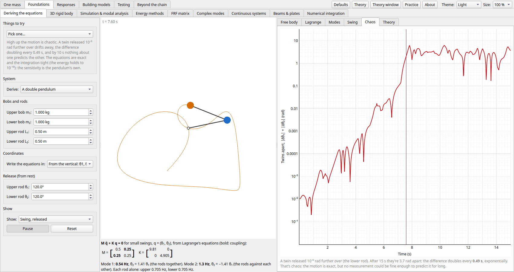
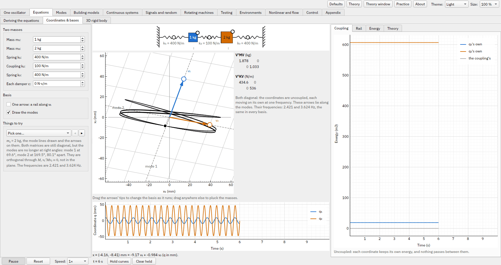

← [One oscillator](one-oscillator.md) · [Contents](../README.md#contents) · [Modes](modes.md) →

# Equations

Where the equations come from: free-body diagrams and Lagrange's equations, the coordinates they're written in,
then a rigid body in 3D.

The pages in the order the app's tabs take them.

- [Deriving the equations](#deriving-the-equations): free-body diagrams against Lagrange's equations: a car in bounce and pitch, and a double pendulum
- [Coordinates & bases](#coordinates--bases): two masses whose motion is a point in a plane: any basis, the coupling it brings, the modes that remove it, and Rayleigh's quotient on a rail
- [3D rigid body](#3d-rigid-body): a body tumbling in space: its inertia tensor, principal axes, Euler's equations and the intermediate-axis flip

## Deriving the equations

A car's body in bounce and pitch, one rigid body on a front and a rear spring, derived two ways with the
page's own numbers written in: free-body diagrams (forces, and moments about G or another point) and
Lagrange's equations (T, V and Rayleigh's D, then their derivatives). The coordinates can be the centre
of mass, any point P on the body, or the two ends: M, C and K change (static coupling in K, dynamic in
M, the free-body diagram's rows not symmetric until mixed), the frequencies don't. The car swings in each
mode about its node, the modes are swept against the rear spring, and it rides a speed hump to show
Olley's flat ride.

The page's second system is a double pendulum. Its free-body diagram needs rod 2's pull, found and
eliminated; Lagrange's equations never see it. Its whole equations are nonlinear, and it is linearized only
after differentiating, in the rods' angles or the elbow's bend. Released, it swings by the whole equations
(DOP853, the energy held to 10⁻¹⁰) beside the linear model. Released high, a twin a millionth of a radian
further over drifts away exponentially: chaos.

## Coordinates & bases

Two masses between two walls, tied to each other by a coupling spring, running live. Their configuration is one
point in the (x₁, x₂) plane, which traces a Lissajous figure as they swing. Two arrows on the plane are a basis,
x = q₁v₁ + q₂v₂: drag them while it runs and the matrices beside them, VᵀMV and VᵀKV, change, their off-diagonal
coupling marked (static, dynamic, both or none), while the frequencies never do. The coordinates' traces below are
described again in the new basis, the past too. Along the modes both matrices are diagonal and each coordinate is
one clean sine; with unequal masses the modes aren't at right angles, only orthogonal through M. The Coupling tab
splits the energy into each coordinate's own and the coupling's: plucking one mass, it beats across and back. Take
one arrow away and the masses run on a rail, at Rayleigh's quotient: the Rail tab is built by hand, each rail's
measured frequency landing at its angle, lowest along mode 1. Masses and springs change as it runs by their grips;
the rail can be put on, turned and taken off, each change booked in the energy balance.

## 3D rigid body

A body free to turn any way, with no gravity and no support: a box, a cylinder or a sphere, with a point
mass that can sit anywhere on it. Its inertia tensor about the centre of mass comes from the shape's own
moved there by parallel axes plus the point mass's, products of inertia and all, and its eigenvectors are
the principal axes (the *Inertia* tab writes both out). Spun about one of them, L is along ω; about any
other they point apart, L fixed in space and ω wandering round it. The notes derive L = Iω, the transport
theorem for vectors in turning axes and Euler's equations, and why a body spun about its middle axis turns
over and back (the tennis-racket effect: 1° off at 6 rad/s, the default box turns over in about 1.4 s).
A torque held in space or in the body for a set time (or a *Kick*) changes L by its impulse. The
*Components* tab plots ω, L, τ or the tensor in fixed, body or principal axes, with the equations written
out with numbers at any instant, and *Check* compares the energy and L with what the torque put in.

The *Orientation* tab writes how the body is turned four ways at once: the rotation matrix, Euler's z-x-z
angles (with their rates, which blow up near the gimbal lock at θ = 0), the quaternion with its axis and angle,
and the 4 × 4 homogeneous transform that carries the point mass to space. Its start pose is set there as
Euler angles: at θ = 0 changing φ or ψ turns the body the same way. The *Drift* tab steps the same torque-free run as a
rotation matrix, as Euler angles and as a quaternion at one coarse step and plots how far each drifts from the
true orientation: the quaternion least, the matrix more (and it stops being a rotation), the Euler angles most,
and from a start near the lock they fail. The view can trace ω's path in space or on the body itself, where,
torque-free, it runs round a closed loop (Poinsot's polhode). The body is drawn with shaded faces, lit
from the upper left, so its turning reads at a glance.

---

← [One oscillator](one-oscillator.md) · [Contents](../README.md#contents) · [Modes](modes.md) →
