← [Equations](equations.md) · [Contents](../README.md#contents) · [Continua and models](continua-and-models.md) →

# Modes

A chain of masses: its modes, estimates from the energies, its frequency responses as a sum of modes, and modes made complex by damping.

The pages in the order the app's tabs take them.

- [Simulation & modal analysis](#simulation--modal-analysis): one mass, then a chain of them: modes, damping, energy, forcing, absorbers, friction
- [Energy methods](#energy-methods): Rayleigh, Dunkerley, Rayleigh–Ritz and Holzer: frequencies from the energies, and how good they are
- [FRF matrix](#frf-matrix): every receptance Hjk, and how the modes add up to it
- [Complex modes](#complex-modes): when damping makes the modes complex, and what the usual approximation misses
- [Rigid body on mounts](#rigid-body-on-mounts): a machine on four mounts in 3D: six coupled modes, the elastic centre, and decoupling by tilting them

## Simulation & modal analysis

- **Edit any mass, stiffness, or damping value while the simulation runs.** The state is
  kept, so you see the system respond to the change.
- **Give a mass friction** (*System parameters → Ff*): Coulomb friction against the
  floor, the force μN opposing the sliding. This makes the chain nonlinear. Released from
  rest, a single mass still swings at its undamped natural frequency, but loses a fixed
  4Ff/k of amplitude per cycle (a straight-line decay, not an exponential one) and
  sticks for good at the first turn within Fs/k of rest, Fs being the
  static friction. *Static / sliding friction* (one ratio for the whole floor) sets
  Fs above Ff: a stuck mass then holds until its springs pull harder
  than Fs, and lurches off against the smaller Ff, which gives
  stick-slip under a slow pull. The simulation steps friction exactly between stick and slip, and finds each change
  within its step to fourth order. The modes and
  frequency responses use the linear chain, with two approximations of friction beside them:
  the modal table's *ζ friction* column (each mode's equivalent viscous damping at the
  release amplitude, ceq = 4Ff/πωX, so it falls as the amplitude
  grows), and on the *Frequency response* tab a dash-dot describing-function response at the
  excitation's amplitude, where a mass that friction holds still leaves a gap.
- **Apply a force to any mass**: a step, a harmonic `F sin(2πft)`, a rectangular pulse, or a
  chirp (a frequency sweep). Press **Space** (or the button) to switch it on and off, and
  watch the transients as it starts and stops.
- **Shake the ground instead** (base excitation): the wall moves with the same waveforms,
  and the *Frequency response* tab shows the transmissibility (below).
- **Pluck a mass**: drag any mass sideways with the mouse and let go (below).
- **Tune the drive frequency to a natural frequency** from the "Tune to…" menu to see
  resonance build up.
- **Release a mode**: select a mode in the table and click *Release selected mode*. The
  masses start from that mode shape and vibrate freely. The plot window can be fitted to
  a number of cycles of any mode.
- **Switch between two modal-analysis methods** (below), and compare them on the same
  system.
- **Plot the motion in modal coordinates** (*Plot coordinates → Modal*, above the time
  histories): one curve per mode instead of one per mass (below).
- **Watch the energy** in the bars beside the animation: kinetic and potential, an exact
  balance of energy in (release, force) against energy out (stored, dissipated), and each
  mode's share. *Plot coordinates → Energy* draws the same quantities against time (below).
- **Plot the force in every spring and damper** (*Plot coordinates → Element forces*):
  the springs, the dampers, or both together (below).
- **Load a preset** (*System parameters → Preset*): the plain chain, an undamped
  vibration absorber, a tuned mass damper with Den Hartog's tuning, or a damper on the roof
  of a 4-storey building shaken by the ground, each with the excitation that shows it off
  (below).
- **Slow motion** (0.05× to 2×) for the higher modes, and auto-scaled animation and plots
  so small motions stay visible.

### Plucking a mass

Drag any mass in the animation sideways and let go. While you hold it, the force is
switched off and time stands still. The other masses take the static shape a slow pull
gives, with every spring balanced, and a red arrow shows the force your hand needs. Let go
and the chain vibrates freely from that shape. The static shape is close to the first
mode, so most of the energy starts in mode 1 (see *Energy: by mode*). Pull on m1 instead and
more of it goes into the higher modes.

With friction the other masses stay where they are until their springs pull harder than the
static friction, and then slide only until the pull has fallen to the sliding friction. The
shape depends on the path: drag a mass out and back and the others stay out, held by
friction, and when you let go nothing may move.

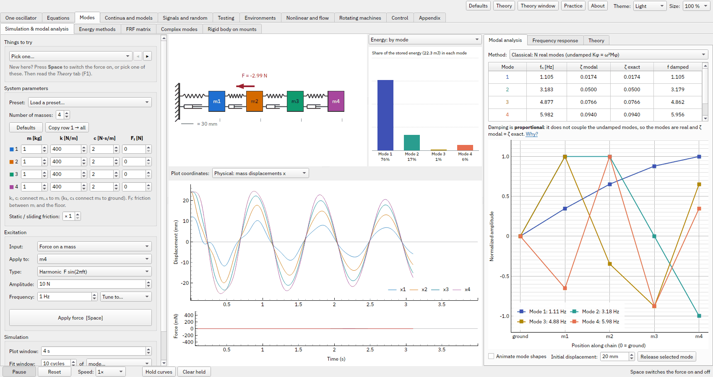

### Chirp and ground motion

*Type → Chirp* sweeps the drive frequency from a start to an end frequency over the sweep
time (linear, or logarithmic for equal time per octave), then stops. Each mode swells in
turn as the sweep passes it, and the dashed drive line on the *Frequency response* tab
follows the frequency. Below, a 40 s sweep from 2 to 7 Hz at m4 is plotted in modal
coordinates: mode 1 rings from the switch-on and decays, then modes 2, 3 and 4 swell
one after the other. Sweep faster and the peaks come later and lower.

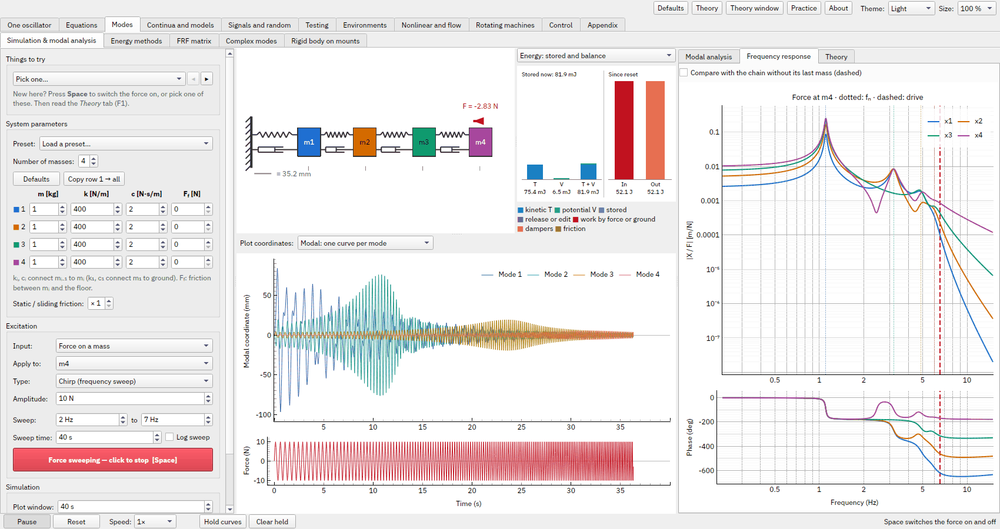

*Input → Ground motion (base)* moves the wall instead of pushing a mass, with the same
waveforms and an amplitude in mm. The ground reaches the chain only through k1
and c1, as the force k1xg + c1ẋg on m1.
The plots show absolute displacements, the lower plot shows xg, and the
*Frequency response* tab shows the transmissibility |Xi/Xg|. It is 1
at low frequency, where the chain moves with the ground, and falls away above the modes
(for a single mass, below 1 only above √2 fn, whatever the damping).
The energy balance counts the work the moving ground does. Element forces, modal
coordinates and energy by mode use the motion relative to the ground.

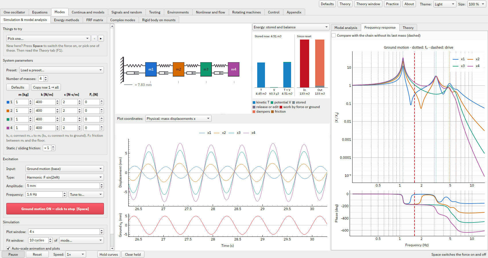

### Vibration absorbers and tuned mass dampers

*System parameters → Preset* loads a chain with one small mass hung on the end of it, tuned
to a mode of the chain it is attached to, and sets up the excitation. The *Frequency
response* tab then also shows the chain without it, thin and dashed (*Compare with the
chain without its last mass*).

- **Vibration absorber (undamped)**: a 0.1 kg absorber on a 1 kg, 3.18 Hz machine, tuned
  to 3.18 Hz with no damper. Driven there, the machine stands still: the absorber's
  spring pushes back with exactly the applied force. The one resonance becomes two, one
  either side.
- **Tuned mass damper (Den Hartog)**: a 5% damper tuned to fa/f1 =
  1/(1 + μ) with ζa = √(3μ/8(1 + μ)³) (relative to f1, as Den Hartog defined it). The resonance at 40 times the static
  deflection becomes two flat peaks under 6. Set c2 to 0 or to 5 to see why the damping
  has an optimum.
- **TMD on a 4-storey building**: the default chain shaken by the ground at its first
  mode, with a damper on the roof sized from mode 1's *modal mass* there
  (1/φroof², φ mass-normalized).

Edit the absorber's k and c to see what mistuning does. The *Theory* tab derives the
antiresonance, the fixed points and Den Hartog's tuning.

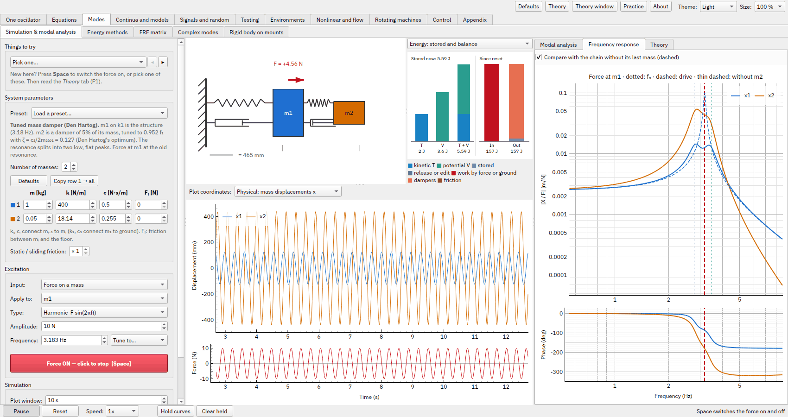

### Two modal-analysis methods

The *Method* selector on the Modal analysis tab switches between two ways of solving for
the modes.

**Classical: N real modes.** The undamped eigenproblem gives N natural frequencies and
real mode shapes; damping is estimated per mode. The table compares this estimate
(ζ modal) with the exact value (ζ exact). The note under the table says whether the
damping is *proportional*. If it is not, the estimate is only an approximation, and
releasing a real mode shape excites other modes too. Below, with only `c1` raised to 15,
the release of mode 3 leaves slow mode-1 motion behind:

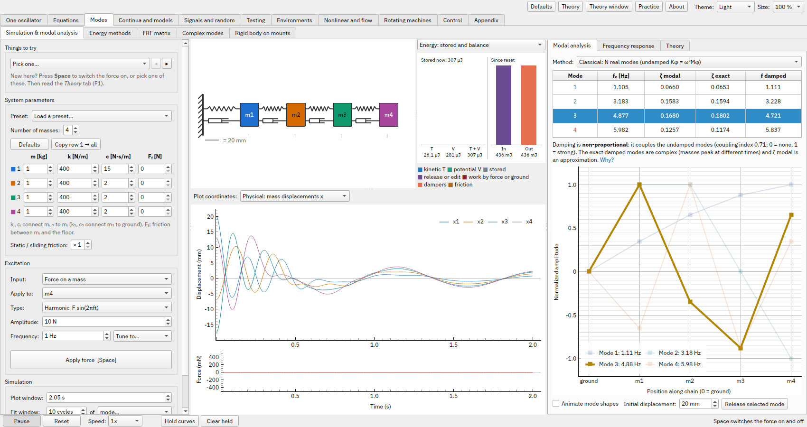

**State-space: 2N complex modes.** The full damped problem is solved in first-order form,
which gives all 2N eigenvalues: complex-conjugate pairs λ, λ* for oscillatory modes (and
real eigenvalues for overdamped or rigid-body motion). Selecting a row shows its complex
mode shape in a complex-plane (phasor) plot, with the amplitude and phase of each mass.
Phases other than 0° or 180° mean the masses peak at different times. Releasing a
complex mode sets both displacement and velocity, so on the same system only that mode
responds and decays cleanly:

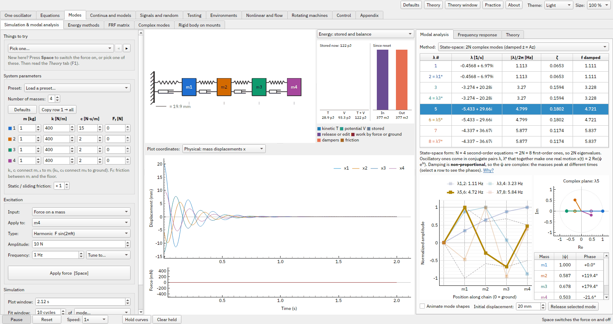

### Modal coordinates

*Plot coordinates → Modal* splits the motion into one curve per mode. Each curve is that
mode's share of the displacement of the mass it moves most, so its size compares
directly with the physical plot. The curves follow the *Method* selector:

- **Classical**: q = ΦTMx with the real mode shapes, so x = Σ φrqr
  exactly. With non-proportional damping these coordinates are coupled. Release mode 3 with
  `c1` = 15 and modes 1 and 2 pick up motion.
- **State-space**: η = V−1z with the complex eigenvectors, one curve 2 Re(η) per
  conjugate pair. These decouple for any damping. A released complex mode moves only its
  own curve.

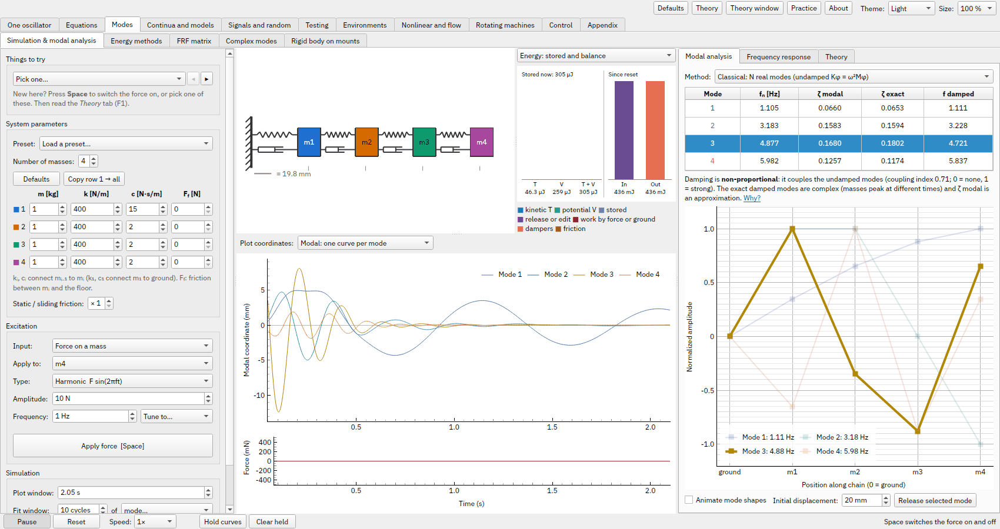

### Energy

The panel beside the animation has two views:

- **Stored and balance**: kinetic energy T, potential energy V and their sum, then a ledger
  since the last reset. *In* is the energy given by a release or a parameter edit plus the
  work done by the force. *Out* is the energy stored now plus the energy dissipated by the
  dampers and by friction. The simulator integrates the work and the dissipation exactly, so
  the columns always match.
- **By mode**: each undamped mode's share of the stored energy,
  ½(q̇r² + ωr²qr²). The shares always add up to T + V. With
  non-proportional damping the dampers move energy between modes. Release mode 3 with
  `c1` = 15 and within a second most of the energy left is in mode 1.

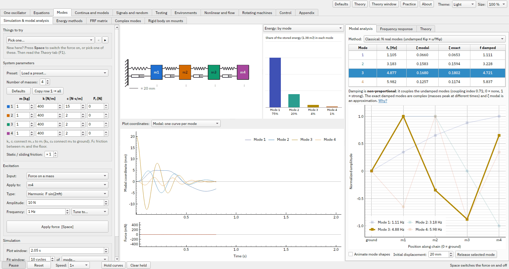

*Plot coordinates → Energy* draws the ledger as time histories: T, V and T + V, the energy
given by releases and edits E0, the work done by the force W, and the energy
dissipated by the dampers D and by friction Df. At every sample
E0 + W = T + V + D + Df. Release a mode and T and V
swap twice per cycle while T + V decays and D rises towards E0. Drive the
chain just below a natural frequency and the stored energy beats. W falls whenever the
force pushes against the motion, and D keeps rising.

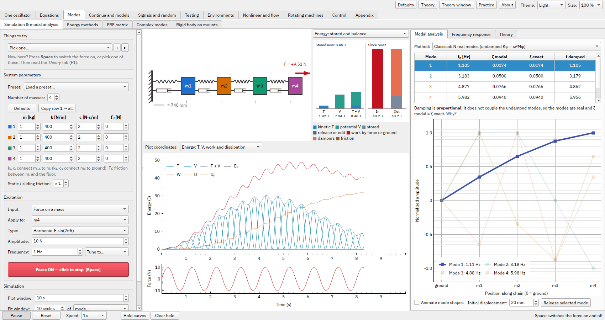

### Element forces

*Plot coordinates → Element forces* plots the tension in each element, in the colour of
its row under *System parameters*. Element i joins mass i−1 to mass i, and element 1 joins
mass 1 to the ground. A second menu picks what to plot:

- **Springs**: ki(xi − xi−1)
- **Dampers**: ci(ẋi − ẋi−1)
- **Spring + damper**: the total force the element carries. For element 1 this is the
  force on the ground.

Positive is tension. Apply a step force at the last mass and every spring rings about the
same static force, overshooting to about twice it. Once the motion dies away every spring
carries exactly the applied force and the dampers carry none. At resonance the elements
carry several times the applied force, and the damper force leads the spring force by a
quarter cycle.

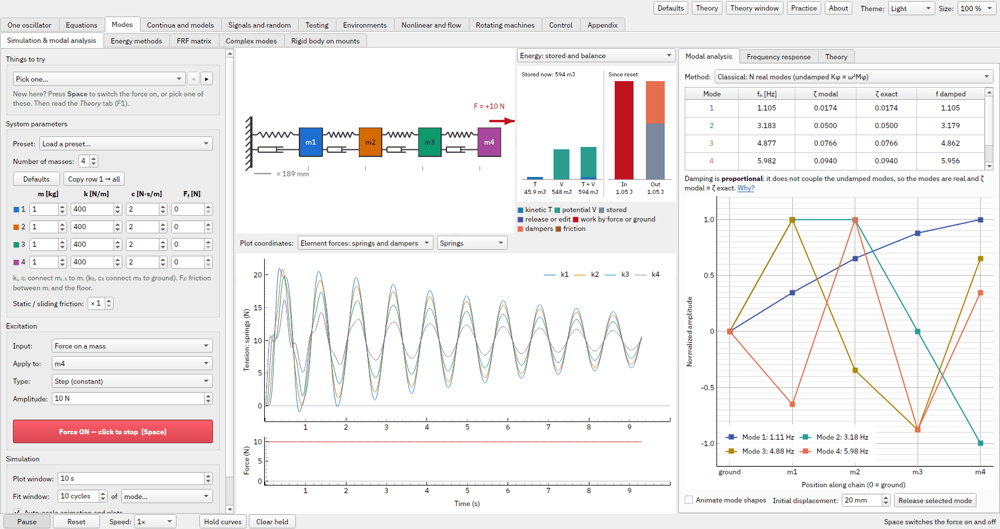

### Frequency response

The receptance |X_i / F| and phase of every mass for a force at the selected mass. The
natural frequencies are dotted and the current drive frequency is dashed.

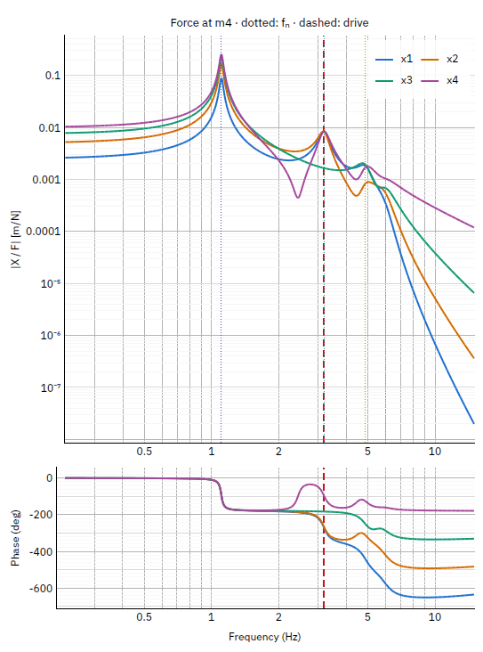

## Energy methods

Frequencies from the energies, on the Simulation page's chain: Rayleigh's quotient (from the static
deflection, a straight line, or a pass of inverse iteration), always above f₁ by a margin second order in
the shape's error; Dunkerley's sum, below it; Rayleigh–Ritz with r shapes, every estimate above its mode
and falling as r grows; and Holzer's table, stepping from the ground to the free end at a trial
frequency until the force left over is zero. Drag the trial shape's points to draw your own, and watch
Rayleigh's estimate follow and never go under f₁.

## FRF matrix

The *Frequency response* tab shows one column of the receptance matrix. The **FRF matrix**
page shows all N × N terms Hjk = xj/Fk as a grid of small
plots (row: response, column: force), on shared axes so their sizes compare directly.

- **Show** magnitude, phase (unwrapped), real part or imaginary part. The large plot on the right
  shows the selected term as magnitude with phase, or real with imaginary part.
- **Modes included in the sum**: each term is a sum of one term per mode. Untick modes to see
  the truncated modal sum (dashed red) against the full solution (black), and each mode's term
  in its own colour. The real part shows best how the terms add. The large plot shades the
  frequency band where the sum differs most from the full solution, and lists the **static
  compliance** (ω = 0): the ticked modes' sum against K⁻¹, and each mode's share of it.
- **Build H mode by mode**: the *First* slider ticks the first r terms and leaves the rest out, and
  *Start* on the run bar steps it from one term to all of them: each term adds its peak, and the dips
  appear where neighbouring terms cancel. Reset sums them all again.
- **Exact or classical terms**: the exact expansion uses the complex (state-space) modes and
  always sums to the full solution. The classical one uses the real modes with ζ modal, and
  misses even with every mode when damping is non-proportional.
- **Several forces at once**: Ctrl+click more plots in a row, or tick more forces, to see
  xj = Σk HjkFk built from its terms.
- **Theory**: reciprocity, modal constants, why antiresonances appear (and how many), and
  truncation.

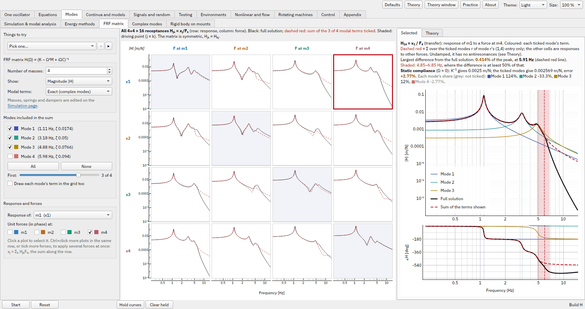

## Complex modes

The **Complex modes** page looks at what the damping does to the chain's modes. With proportional
damping (ΦTCΦ diagonal: here, a damper per spring in proportion to it) every mode keeps its
real, undamped shape; a damper on its own couples the modes, and the exact (state-space) shapes become
complex: each mass peaks at its own time, and the nodes move. It follows the chain on the Simulation page.
The mode looked at swings on its snapshots with its nodes marked, standing still or sliding, and *One damper
at* gathers the chain's damping into one damper and slides it along the chain.

- **The mode in the complex plane**: one arrow per mass, with the best-fit line, and its snapshots over
  half a cycle: one shape, scaled, for a real mode; changing shape, the nodes wandering, for a complex one.
- **How complex**: every mode's MPC (modal phase collinearity: 1 real, 0 spread evenly), MPD (mean
  phase deviation from the best-fit line) and MAC with the undamped shape, and the phases' scatter
  (*Phases* tab).
- **The proportional approximation** (ζ = φTCφ/2ω, the off-diagonal terms dropped): its poles
  against the exact ones in the table, its FRF against the exact one (*FRF*), and a *Free decay* from an
  undamped mode's shape: exactly that mode with proportional damping, otherwise the damping hands some
  of the motion to the others.
- **Sweep**: one damper (or spring) swept over four decades, the rest of the chain as it is: each mode's
  exact pole (the root locus), its damping ratio exact and approximated, and its MPD. A damper's modes damp
  more as it grows, peak, and fall again as it locks its joint and the modes become the locked chain's,
  one pair leaving as overdamped roots; the approximation's ζ grows for ever. Drag a pole along its
  locus and every mode's pole slides with it; let go and the chain takes that value.
- **Identification**: an FRF column with a little noise fitted by LSFD on the exact poles, with complex
  modes and with real (normal) modes: their shapes' MAC with the exact ψ and the undamped φ, the
  complex fit's MPC, and how far each fit's FRF misses.
- **Chains to try** (loaded into the Simulation page): proportional dampers, one damper at the base, one
  at the top, a strong damper that locks a joint (a mode overdamped), and a tuned mass damper's two close
  modes. *Make it proportional* sets ci = βki, keeping mode 1's ζ.

With one damper at the base, mode 3 is the most complex: its masses' phases spread up to 54° from the
best-fit line. The approximation puts mode 4's damping at twice the exact value, and a release in
mode 3's undamped shape passes half of it to mode 2.

Swept, the same damper gives mode 1 at most ζ = 0.147, at 60 N·s/m; stiffer, it locks m1 to the base and
the modes become those of the three masses above it. Fitted with real modes, this chain's FRF misses by
29 %, and mode 3's shape has a MAC of 0.51 with the exact one; with complex modes it misses by 0.28 %,
the noise's share.

## Rigid body on mounts

A machine (a uniform box) on four mounts, each stiff along its axis and softer across it, moving in all
six ways: K = Σ Tᵀ Km T against M, the six modes swinging in 3D, and each one's kinetic energy
split among x, y, z, roll, pitch and yaw. Mounts below the centre of mass couple sway with roll; an
off-centre centre of mass couples bounce with pitch. The elastic centre (where a force moves the body
without turning it), each plane's beside the mounts' lines of action, and focalizing: tilting the mounts
toward the middle lifts the roll plane's centre to the centre of mass, and sway and roll are pure again.
Driven by a turning unbalance or a firing torque, (K(1 + iη) − ω²M)q = Q with rubber's loss factor: the
force through each mount and the floor's total against the speed (isolated above √2 times the highest mode,
amplified about 1/η at each), which modes the load drives, and the torque roll axis I⁻¹n that engine mounts
are aimed at.

---

← [Equations](equations.md) · [Contents](../README.md#contents) · [Continua and models](continua-and-models.md) →
