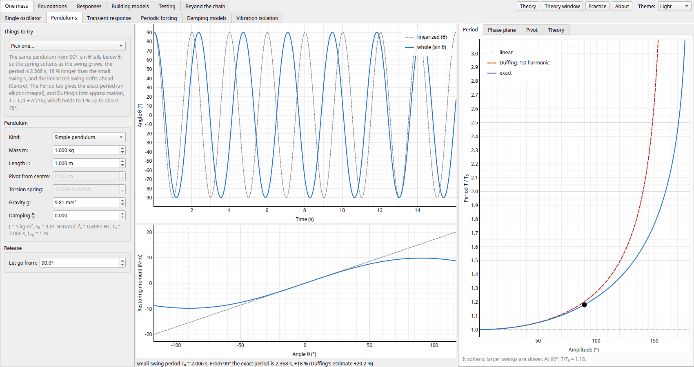
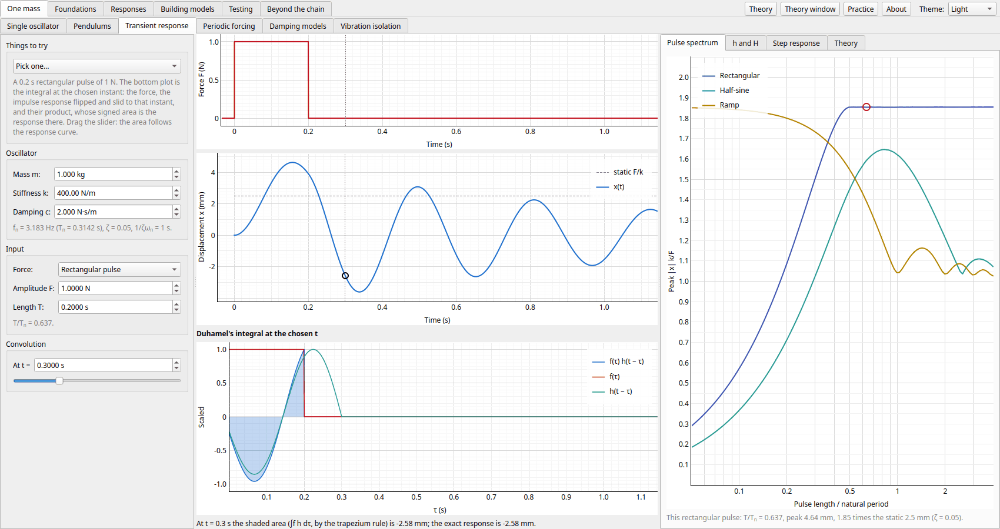

[Contents](../README.md#contents) · [Foundations](foundations.md) →

# One mass

The first group works on a single mass on a spring and a damper, each page with its own small model,
worked out in closed form or by the same exact first-order-hold step as the chain, as soon as a control
changes.

The pages in the order the app's tabs take them.

- [Single oscillator](#single-oscillator): one mass on a spring and a damper: free decay, damping, resonance, half-power, beats, poles
- [Pendulums](#pendulums): gravity as the spring, large swings that soften, and the rotational form of every one-mass formula
- [Transient response](#transient-response): an impulse, a step or a pulse: the impulse response, convolution, and how long a pulse has to be
- [Periodic forcing](#periodic-forcing): a repeating force as a Fourier series: harmonics, Gibbs, resonance through a harmonic
- [Damping models](#damping-models): viscous, hysteretic, friction and viscoelastic damping: their loops, losses and decays
- [Vibration isolation](#vibration-isolation): a machine on mounts: transmissibility, static deflection, damping, two stages, start-up

## Single oscillator

m ẍ + c ẋ + k x = f, from every side. The free vibration from any start, with its envelope, its peaks
and the log decrement measured from them (or ζ = 0.1, 1 and 2 side by side); a harmonic force or a
rotating unbalance switched on from rest, beside its steady state; and four views of the receptance:
amplification and lag with the half-power band marked, the Nyquist circle, the phase plane, and the
poles in the s-plane, where a click puts them and the page works out k and c. Nine trials include
critical damping, beats, the undamped resonance's straight-line growth and the unbalance's 180° turn.

## Pendulums

Gravity as the spring. A simple pendulum, a rod swinging about any pivot (with its centre of percussion
and the pivot that swings fastest), a disc on a torsion wire, and an inverted pendulum held up by a
spring, each linearized into the single oscillator's formula with J for m and the moment's stiffness for
k. Kept whole, sin θ softens the hanging pendulum: the exact period by quadrature beside Duffing's
estimate, the phase plane's orbits out to the separatrix, and an inverted pendulum that leans over and
buckles once gravity's negative stiffness beats the spring.

## Transient response

An impulse, a step, a ramp, a rectangular or a half-sine pulse on the oscillator. The response is the
convolution of the force with the impulse response h(t), and the page draws the integral itself at any
instant (the force, h flipped and slid, and their product, whose area is the response there). Its tabs
set h(t) beside its Fourier transform, the receptance; measure a step's overshoot and settling time; and
plot each pulse's peak response against its length over the natural period, the shock spectrum's
single-oscillator form. The Theory brings in the Laplace transform: the transfer function, its poles, and
partial fractions back to time.

## Periodic forcing

A force that repeats (a square, sawtooth or triangle wave, a rectified sine, a pulse or impulse train) as
its Fourier series, each harmonic through H(kω₀), against the exact steady state (one period stepped
from the state that repeats). The harmonics' bars, the Gibbs overshoot, how fast smooth and sharp waves
converge, and resonance through a harmonic: a slow drive whose third harmonic sits on fn.

## Damping models

Viscous, hysteretic (structural), Coulomb friction and viscoelastic (Zener) damping, each matched to the
same oscillator so it loses the same energy per cycle at fn. The hysteresis loops (damping
force alone, or with the spring as a test machine draws them), the energy per cycle, storage stiffness
and loss factor against frequency, the forced response (friction's by its describing function, which
can't bound a resonance) and the free decays (friction's a straight line that stops off centre).

## Vibration isolation

A machine with a rotating unbalance on mounts sized by their static deflection (fn =
15.76/√δmm Hz). The transmissibility against frequency over fn (crossing 1 at √2
whatever the damping), the force on the floor against speed, a run-up through the mounts' resonance
stepped exactly, and a design chart of the sag each isolation needs. Mounts can be a spring and damper, a
relaxation mount (the damper on a spring) or two stages, and an inertia block can be added.

---

[Contents](../README.md#contents) · [Foundations](foundations.md) →
