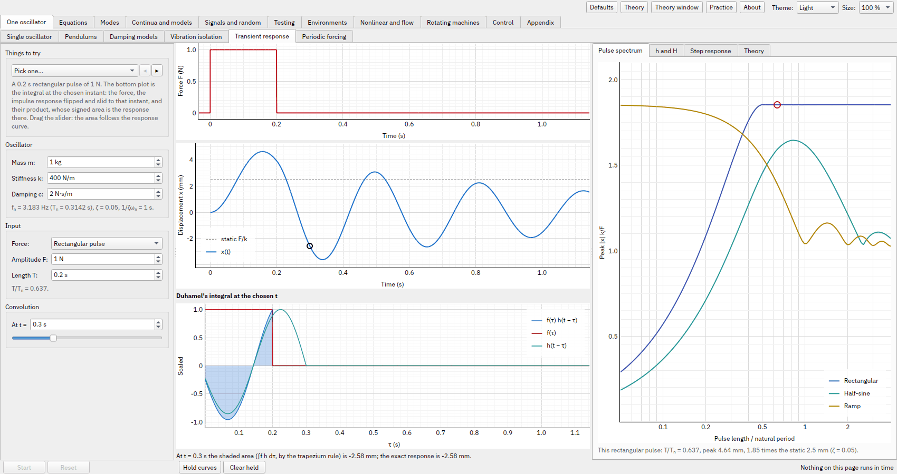

[Contents](../README.md#contents) · [Equations](equations.md) →

# One oscillator

The first group works on a single mass on a spring and a damper, each page with its own small model,
worked out in closed form or by the same exact first-order-hold step as the chain, as soon as a control
changes.

The pages in the order the app's tabs take them.

- [Single oscillator](#single-oscillator): one mass on a spring and a damper: free decay, resonance, half-power, beats, poles, and the damper's law: viscous, hysteretic, friction, viscoelastic
- [Pendulums](#pendulums): gravity as the spring, large swings that soften, and the rotational form of every one-mass formula
- [Vibration isolation](#vibration-isolation): a machine on mounts: transmissibility, static deflection, damping, two stages, start-up
- [Transient response](#transient-response): an impulse, a step or a pulse: the impulse response, convolution, and how long a pulse has to be
- [Periodic forcing](#periodic-forcing): a repeating force as a Fourier series: harmonics, Gibbs, resonance through a harmonic

## Single oscillator

m ẍ + c ẋ + k x = f, running live: the first page rebuilt to #478's standard. The mass is worked out as it moves
(the exact FOH step), with the forces on it drawn beside it as a free-body diagram, on the mass held still so it reads as it runs. Pluck it, or drag the handles on
the mass, the spring and the damper to change m, k and c while it runs: the motion carries on by the physics (a
captured mass keeps its momentum, a spring changed at a stretch costs ½Δk·x²), and the time plots keep what came
before, with the change marked. The readout measures the log decrement from the peaks after a pluck. Drive it
with a force or a rotating unbalance, and the Frequency response tab fills point by point as each steady swing is
measured: dwell, or press Sweep, then show the theory's curve, half-power band and Nyquist circle over the points.
The Energy tab keeps the books through every change; the Poles tab's poles drag k and c live, beside the phase
plane.

The damper's law is picked under the oscillator's boxes, as it runs (the Damping models page's, merged here: the
same mass and spring): viscous, hysteretic (structural), Coulomb friction or viscoelastic (Zener), each matched
to c so it loses the same energy per cycle at fn, the motion carrying on with the new damping. A
viscous ghost, in grey, is plucked and driven beside it. Hysteretic damping runs as its stand-in in time, a
viscous damper matched at the frequency it runs at; friction sticks and slips by its events; the Zener element
relaxes through its arm. The Loop & loss tab draws the run's own hysteresis loop over its last cycle, with every
law's beside it and the energy it encloses, and the loss factors against frequency; the Frequency response tab
draws the law's curve (friction's resonance runs away past 4Ff/π) and the driven state's force
phasors beside the Nyquist plot. Sixteen Things to try, after the controls, are setups to come back to, the
oscillator's eight and then the laws'; their predictions are asked once you've handled it.

## Pendulums

Gravity as the spring, the single oscillator turned, and live: the pendulum swings as it's stepped, and
changes as it swings. A simple pendulum, a rod swinging about any pivot (with its centre of percussion and
the pivot that swings fastest), a disc on a torsion wire, and an inverted pendulum held up by a spring, each
linearized into the single oscillator's formula with J for m and the moment's stiffness for k. Pluck it by
the bob, or drag the rings on it as it swings: shorter, heavier, stiffer, the rod's pivot moved, and it
carries on with its angular momentum kept, so pulling the string in at the bottom and letting it out at the
ends pumps the swing up, as on a playground swing. Beside it, the moments about the pivot, a row each, with
the string's tension under them. The Period tab is built swing by swing: each whole swing lands its period
at its amplitude, and the exact period by quadrature and Duffing's estimate can be drawn over the points.
The Phase plane traces the swing over the orbits out to the separatrix, and the Energy tab books the hand's
work and each change's; an inverted pendulum on too weak a spring leans over and buckles.

## Vibration isolation

A machine with a rotating unbalance on mounts sized by their static deflection (fn =
15.76/√δmm Hz). The transmissibility against frequency over fn (crossing 1 at √2
whatever the damping), the force on the floor against speed, a run-up through the mounts' resonance
stepped exactly, and a design chart of the sag each isolation needs. Mounts can be a spring and damper, a
relaxation mount (the damper on a spring) or two stages, and an inertia block can be added. The Start-up
tab draws the machine on its mounts above the run-up, moving with it, its unbalance turning, with the force
on the floor beside what a rigid mount would pass at that instant; pull the machine and let go and,
stopped, it rings on its mounts.

## Transient response

An impulse, a step, a ramp, a rectangular or a half-sine pulse on the oscillator. The response is the
convolution of the force with the impulse response h(t), and the page draws the integral itself at any
instant (the force, h flipped and slid, and their product, whose area is the response there). Its tabs
set h(t) beside its Fourier transform, the receptance; measure a step's overshoot and settling time; and
plot each pulse's peak response against its length over the natural period, the shock spectrum's
single-oscillator form. The Theory brings in the Laplace transform: the transfer function, its poles, and
partial fractions back to time.

## Periodic forcing

A force that repeats (a square, sawtooth or triangle wave, a rectified sine, a pulse or impulse train) as
its Fourier series, each harmonic through H(kω₀), against the exact steady state (one period stepped
from the state that repeats). The harmonics' bars, the Gibbs overshoot, how fast smooth and sharp waves
converge, and resonance through a harmonic: a slow drive whose third harmonic sits on fn.

---

[Contents](../README.md#contents) · [Equations](equations.md) →
