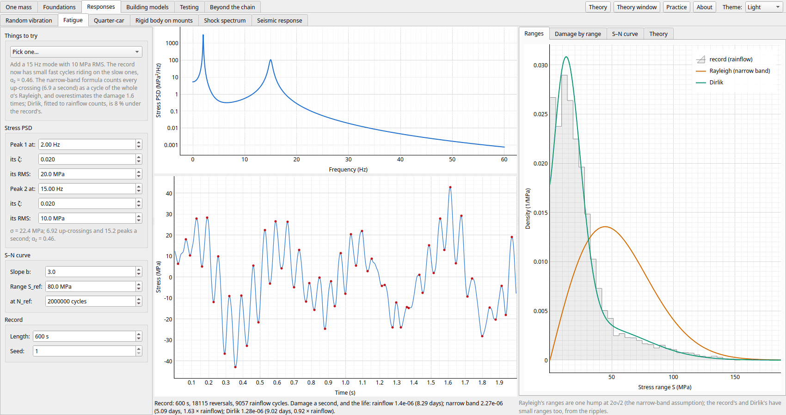
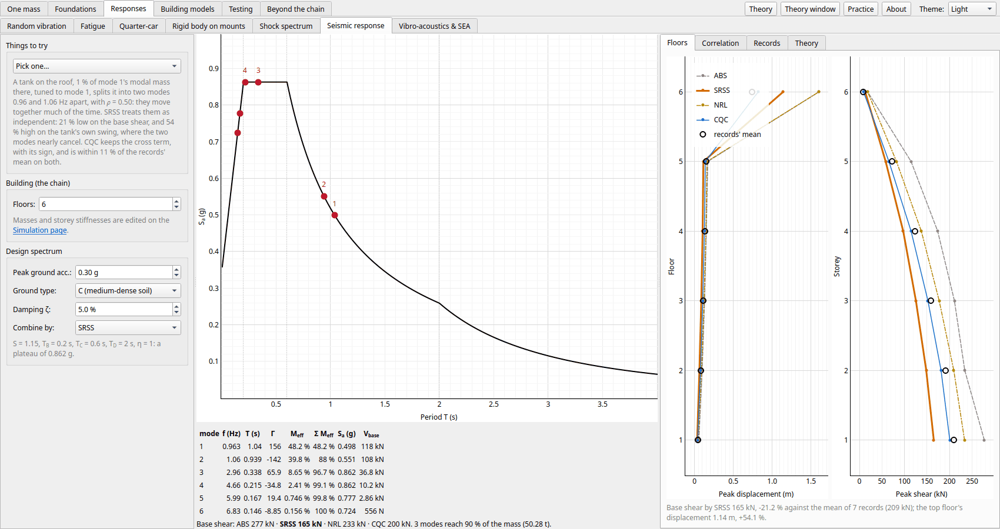

← [Foundations](foundations.md) · [Contents](../README.md#contents) · [Building models](building-models.md) →

# Responses

The pages in the order the app's tabs take them.

- [Random vibration](#random-vibration): a random force or base: the response's spectrum, RMS and peaks
- [Fatigue](#fatigue): a random stress counted by rainflow: S–N curves, Miner's rule, narrow-band and Dirlik estimates
- [Quarter-car](#quarter-car): a suspension on an ISO 8608 road: comfort, grip and travel from the road's PSD
- [Rigid body on mounts](#rigid-body-on-mounts): a machine on four mounts in 3D: six coupled modes, the elastic centre, and decoupling by tilting them
- [Shock spectrum](#shock-spectrum): a short pulse on a bank of oscillators, and on the chain
- [Seismic response](#seismic-response): the chain as a building: a design spectrum, effective modal mass, and ABS, SRSS and CQC against records
- [Vibro-acoustics & SEA](#vibro-acoustics--sea): a panel's sound: radiation efficiency, coincidence, the mass law, and energy flow between parts

## Random vibration

The **Random vibration** page drives the chain with a stationary random input given by its power
spectral density, flat over a band: a force on one mass or on every mass (N²/Hz), or the base's
acceleration, as on a shaker table (g²/Hz). It follows the chain on the Simulation page, without its
friction.

- **The response's PSD**: exact, Gy = H Gu HH, for a mass's
  displacement (relative to the base), its acceleration (absolute, in g) or a spring's force, with
  the record's Welch estimate on top.
- **The RMS**: the cumulative RMS √∫G df climbs a step at each mode, showing each one's share; its
  end is the RMS, against the record's standard deviation and its expected scatter.
- **Miles' equation**: each mode as a single oscillator under white input at its frequency, its RMS
  √((π/2) fn Q G) through the mode shape, and the modes combined by SRSS, in a table beside
  the exact RMS. It misses what isn't resonant, such as a forced mass's acceleration above the modes
  (the mass line).
- **The record**: the input synthesized to the PSD asked for, the chain stepped by the exact FOH
  update, sized from the narrowest peak (four Welch lines across its half-power width, sixteen blocks),
  with the block length and a new record at a click.
- **Statistics** (*Statistics* tab): the record's values against the Gaussian (the fraction beyond
  ±1, 2 and 3σ, skewness and kurtosis), and its peaks against Rice's distribution for the response's
  irregularity α = ν₀/νp. Rice's rates from the PSD's spectral moments, ν₀ = √(m₂/m₀) upward
  zero crossings and νp = √(m₄/m₂) peaks a second, sit beside the counts. Then the
  expected largest peak over a stretch, Davenport's (independent crossings) and Vanmarcke's (crossings
  clumped on a narrow band's envelope), against the record's stretches' largest values.
- **Things to try**: a base shake, a force on the last mass, forces on every mass, the base spring's
  force, a short record, coarse lines (the peak comes out low but the RMS keeps its area), and a
  narrow band on mode 2.

Shaken at 0.01 g²/Hz, 0.32 g RMS, the default chain's last mass sees 0.91 g RMS, 92 % of its mean
square from mode 1 (Q = 29). Miles' equation, mode by mode, is 0.2 % off; the simulated record's RMS
is within its ±2.6 % scatter.

The force in the spring that carries the chain off the base crosses zero 1.14 times a second, as Rice
says from its spectrum. Over a minute Davenport expects its largest peak at 3.11σ; but most of it is
mode 1, a narrow band whose peaks come in clumps, and Vanmarcke's 2.84σ is closer to the record's
2.79σ.

## Fatigue

A random stress of one or two resonant peaks: a record synthesized from its PSD and counted by rainflow,
Basquin's S–N curve and Miner's sum, against the spectral estimates from its moments, the narrow-band
(Rayleigh) formula and Dirlik's. Damage grows as the b-th power of the stress, and a short record's
estimate scatters.

## Quarter-car

A suspension on an ISO 8608 road: the road's PSD in space becomes a PSD in time at the car's speed, and
the body's acceleration (comfort), the tyre's dynamic load (grip) and the suspension's travel follow as
|H|² Gz. The conflict diagram over springs and dampers, each output against the damper, and a
drive over a synthesized road stepped exactly, as the check.

## Rigid body on mounts

A machine (a uniform box) on four mounts, each stiff along its axis and softer across it, moving in all
six ways: K = Σ Tᵀ Km T against M, the six modes swinging in 3D, and each one's kinetic energy
split among x, y, z, roll, pitch and yaw. Mounts below the centre of mass couple sway with roll; an
off-centre centre of mass couples bounce with pitch. The elastic centre (where a force moves the body
without turning it), each plane's beside the mounts' lines of action, and focalizing: tilting the mounts
toward the middle lifts the roll plane's centre to the centre of mass, and sway and roll are pure again.
Driven by a turning unbalance or a firing torque, (K(1 + iη) − ω²M)q = Q with rubber's loss factor: the
force through each mount and the floor's total against the speed (isolated above √2 times the highest mode,
amplified about 1/η at each), which modes the load drives, and the torque roll axis I⁻¹n that engine mounts
are aimed at.

## Shock spectrum

The **Shock spectrum** page puts a short pulse on the base of a bank of single-degree-of-freedom
oscillators, Q = 10 by custom, and plots each one's largest absolute acceleration against its natural
frequency: the shock response spectrum (SRS), what a component with that natural frequency mounted on
the base would see. The pulse's duration is set from the chain on the Simulation page, and the chain's
modes are marked on the spectrum.

- **The pulses**: the classical ones (half-sine, haversine, terminal- and initial-peak sawtooth,
  trapezoid, square), and two measured records with noise and an offset if you like. One is the
  acceleration of a mass on the chain with its base given a half-sine, the shock a component mounted
  there sees. The other is a pyrotechnic-like transient, a burst of damped sines that ends at rest.
  And two records synthesized to a target spectrum (a plateau above a knee, rising 6 dB an octave below
  it, at Q = 10), the way a shaker test is set up: damped sines, which leave the table moving, or
  Smallwood's wavelets, which start and end at rest. Their amplitudes are scaled round by round until
  the spectrum meets the target.
- **The spectrum**: the maximax, and on request the primary (while the pulse lasts) and residual (after
  it) spectra, and the positive and negative ones. Dashed lines mark its two asymptotes: the pulse's
  peak, which stiff oscillators follow, and 2π f Δv, the ringing of soft oscillators that take the pulse
  as an impulse.
- **The oscillator** (*Oscillator* tab): pick a frequency on the spectrum (drag the line, or click), and
  see that oscillator's acceleration against the pulse, its largest value marked, and its spring's
  stretch.
- **The chain's peak** (*Chain* tab): each of the chain's modes is an oscillator at its own frequency
  and damping, driven by its participation factor Γ times the base, so the SRS gives each mode's peak.
  Those peaks are combined by ABS, SRSS and NRL and set against the chain's exact response, for each
  mass's acceleration or each spring's force, with the picked output's history split mode by mode.
- **Four-way paper** (*Tripartite* tab): the pseudo-velocity, with diagonal lines of constant
  displacement and acceleration, and the pulse's Δv and peak acceleration dashed.
- **Pulse shapes** (*Pulse shapes* tab): the six classical pulses' spectra side by side, at the same peak
  or the same velocity change.
- **Things to try**:
  - a half-sine, a square, a terminal-peak sawtooth and a haversine;
  - light damping (Q = 50: the spectrum hardly changes);
  - a component on the chain's last mass;
  - a pyrotechnic transient;
  - the same transient with an accelerometer's zero shift;
  - the chain's modes combined;
  - four-way paper;
  - the pulse shapes compared;
  - damped sines, then wavelets, synthesized to a spectrum.

A 10 g half-sine lasting 100 ms, 0.6 of the default chain's fastest period, puts its modes on the
rising side of the spectrum: a component tuned to mode 1 would see 4.1 g, one tuned to mode 4 15.7 g.
The spectrum peaks at 1.65 × the pulse, for an oscillator whose period is a little longer than the
pulse.

The SRS gives each mode's peak but not when it comes. A shock sets every mode off at once, so their
peaks come early and nearly together: the SRSS, which assumes they come at unrelated times, falls 28 %
short at m4, while NRL lands within 1 %.

## Seismic response

The chain as a shear building on the ground: a design spectrum in the European code's shape, each
mode's participation and effective mass, peak floor displacements, drifts and storey shears from the
spectrum, combined by ABS, SRSS, NRL or CQC, against seven records synthesized to match the spectrum and
stepped exactly. A roof tank tuned to mode 1 shows why close modes need CQC.

## Vibro-acoustics & SEA

How a vibrating panel makes sound. The panel is Beams & plates' simply supported rectangle, set in a
baffle with air on one side. Its bending waves are slower than sound at low frequency and faster at high:
they meet at the **critical frequency** fc = (c²/2π)√(ρh/D), 3.99 kHz for 3 mm of steel. Below
it, neighbouring half waves cancel each other's sound, and only a mode's corners or edges radiate. The
*Radiation* tab gives each mode's **radiation efficiency** σmn from Wallace's integral, and every
mode's at its own resonance against their third-octave average and Maidanik's formula for it.

The *Driven panel* tab drives the panel with a point force, mode by mode. Its band-averaged input power
settles to an infinite plate's F²/16√(Dρh), and the sound it radiates is set by the radiation loss factor
ρcσ/ωm″ against its own damping. *Transmission loss* puts the panel between two rooms: the mass law, 6 dB
per doubling of mass or frequency, until the coincidence dip at fc, where only damping holds the
sound back.

---

← [Foundations](foundations.md) · [Contents](../README.md#contents) · [Building models](building-models.md) →
