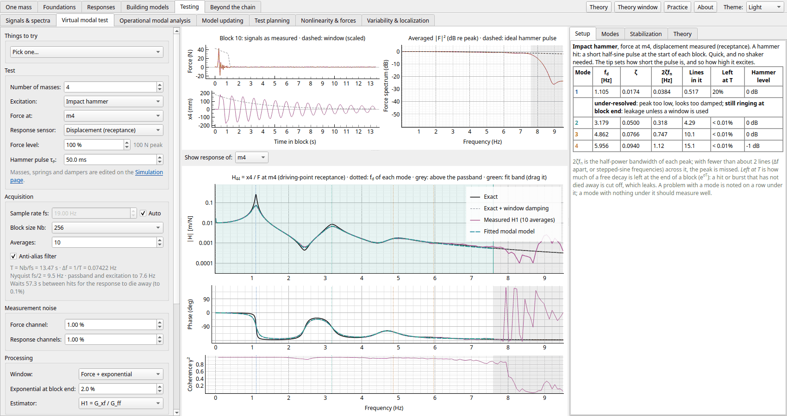
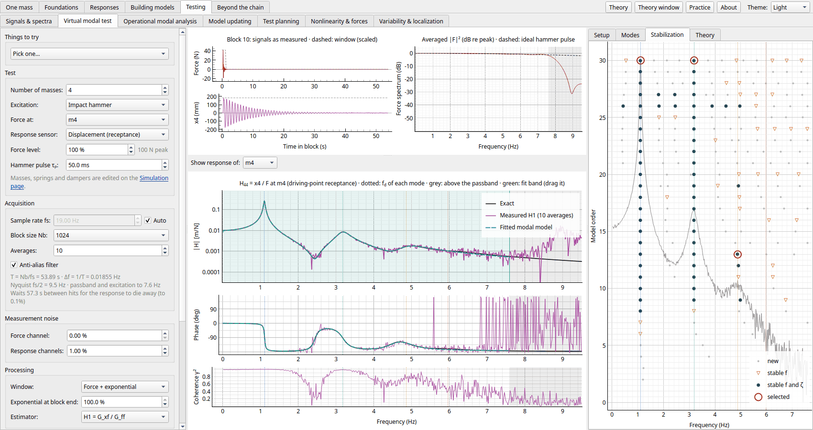
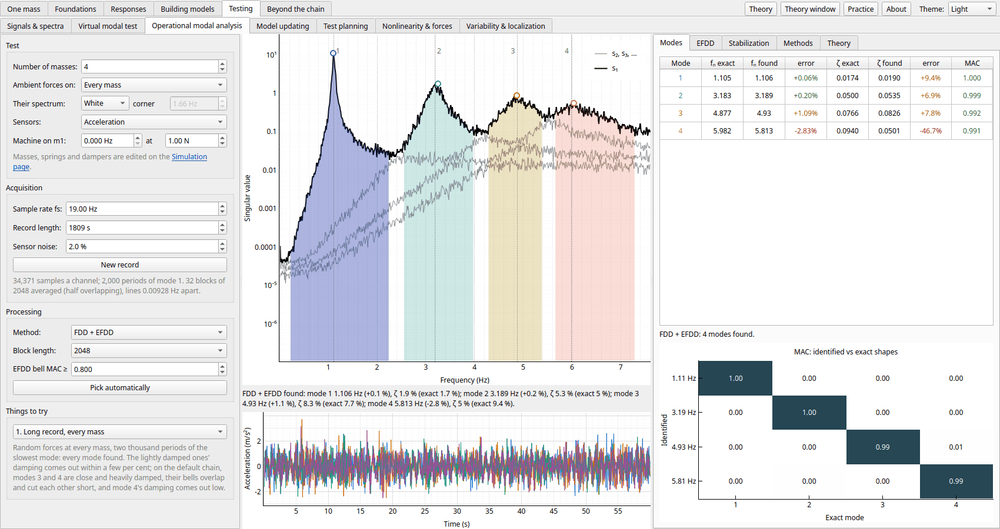
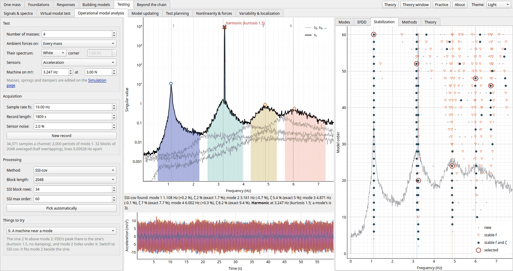

← [Building models](building-models.md) · [Contents](../README.md#contents) · [Beyond the chain](beyond-the-chain.md) →

# Testing

The pages in the order the app's tabs take them.

- [Signals & spectra](#signals--spectra): sampling, aliasing, leakage, windows and averaging, and the transducers that make the signals
- [Virtual modal test](#virtual-modal-test): measuring the FRF from force and response signals, and fitting modes
- [Operational modal analysis](#operational-modal-analysis): the modes from the responses alone, the forces unknown
- [Model updating](#model-updating): comparing a model with a test, and correcting it
- [Test planning](#test-planning): where to put the sensors, and what the structure does as it runs
- [Nonlinearity & forces](#nonlinearity--forces): is the structure linear (levels, sweeps, harmonics), and which force made a response
- [Variability & localization](#variability--localization): scatter in the chain's properties by Monte Carlo, and modes localized in a mistuned ring of blades

## Signals & spectra

Before the measuring pages, the signal processing they use. An analog signal (two tones, a chirp or a
struck mode, plus noise) is sampled, with or without an anti-alias filter, cut into blocks, windowed and
averaged, as a peak amplitude spectrum or a PSD, with each tone's true amplitude marked where it should
show. Its tabs compare the windows' spectra (rectangular, Hann, flat top: main lobe, sidelobes,
scalloping loss, noise bandwidth), draw a spectrogram, and show the transducers as base-excited
oscillators: an accelerometer below its resonance, a seismometer above it, and a sensor's mass lowering
the mode it measures.

## Virtual modal test

The **Virtual modal test** page measures the FRF the way a lab does: from sampled force and
response signals alone, never from M, C and K. A force excites one mass, every mass's
displacement or acceleration is recorded, and the FRF column (receptance or accelerance) is
estimated and drawn over the exact one.
Each step of the measurement, and each error it can bring in, can be switched on and off.

- **Excitation**: impact hammer (the tip sets the pulse length, and so how high it
  excites), continuous random, burst random, periodic random, periodic chirp, or stepped
  sine. The response is simulated with the same exact first-order-hold discretization as
  the simulator. **Force level** scales the force.
- **Response sensor**: displacement (receptance) or acceleration (accelerance, as with
  accelerometers). The acceleration comes from the simulated chain itself, so it is filtered,
  sampled and made noisy like a real accelerometer signal. With response noise, displacement
  loses the high modes and acceleration the band below the first mode; modes are extracted
  after dividing by −ω².
- **Acquisition**: sample rate (automatic, or set by hand), block size (which sets
  Δf = fs/Nb), averages, overlap, and an anti-alias filter. Turn the filter
  off and a mode above Nyquist folds back into the band.
- **Noise** on the force and on the responses, as a percentage of each channel's peak.
- **Processing**: rectangular, Hann, flat-top, or force + exponential windows, and the H1 or
  H2 estimator, with coherence. With the exponential window, a dashed curve shows the exact
  FRF with the damping the window adds.
- Noise and processing act on the data already measured, so the same test can be compared
  with different windows, estimators or noise levels. Blocks are measured a few per frame,
  so the average can be watched settling.
- **Friction and the linearity check**: give the masses friction (Ff on the
  Simulation page) and the response is simulated with stick-slip, step by step. The chain is
  then nonlinear, so the measured FRF depends on the force level and the excitation: a light
  force gives low, heavily damped peaks, a strong one approaches the frictionless FRF, and the
  coherence drops even without noise. *Hold for comparison* keeps one FRF on the plot while you
  measure at another level, the overlay a lab uses to check linearity. A stepped sine reads
  the first harmonic at each frequency, so with friction it is drawn against the
  describing-function FRF at its force level. With 0.5 N on each mass of the default chain,
  the measured |H| is within 0.7% of it (median) at 10 N and 1.6% at 3 N, where the
  frictionless FRF is 5% and 18% off.
- **Setup check**: each mode's half-power bandwidth against Δf, how much of a hit is left
  at the end of the block, the hammer's level at each mode, and aliasing.
- **Theory**: sampling and aliasing, the DFT and leakage, windows, averaging, H1 against H2,
  coherence, the excitation types, and what friction does to a measured FRF.

**Modal parameters** are then extracted from the measured FRF column and compared with the
exact modes:

- **Peak picking**: a mode at each peak, damping from the half-power bandwidth, the shape from
  the FRF at the peak. It shows the limits of the line spacing.
- **Circle fit**: ωn and ζ from the angles on each mode's mobility circle, between
  the frequency lines.
- **LSCF + LSFD**: a common-denominator fit of every response at every model order, shown as a
  **stabilization diagram**. The stable columns are picked automatically, and you can click
  poles to add or remove them. Residues and residual terms then come from a least-squares fit.
- A **fit band**, dragged on the FRF plot, sets which lines are fitted. The fitted modal model
  is drawn over the measurement.
- The **Modal parameters** tab lists fn, ζ and MAC against the exact modes (missed
  and extra modes included), with a MAC matrix. The exponential window's damping can be
  removed from the identified poles.

## Operational modal analysis

A bridge or a running machine can't be hammered: it is shaken by traffic, wind or its own
working, forces nobody measures. The **Operational modal analysis** page drives the chain with
random forces at every mass (or at one), records every mass's response only, and finds the modes
from those responses.

- **The record**: independent Gaussian forces, white or low-passed, through the same exact
  update as the rest of the app, after the start-up transient has died away; then the anti-alias
  filter, sampling, and sensor noise sized to each channel's RMS. The record length, sample rate
  and block length are set from the chain's modes (two thousand periods of the slowest).
- **Frequency domain decomposition (FDD)**: the responses' cross-spectral matrix by Welch's
  method, and its singular values at each line. The first peaks at every mode, its singular
  vector there the shape. Peaks are picked automatically; click to add or drop one.
- **Enhanced FDD**: the lines round each peak whose singular vector still matches make the mode's
  bell, and its inverse transform, the mode's autocorrelation, gives the damped frequency from
  its zero crossings and the damping from its decay (*EFDD* tab).
- **Stochastic subspace identification (SSI-cov)**: a state-space model fitted to the responses'
  correlations at every model order, the stable poles picked automatically from a stabilization
  diagram (or by clicking). It fits every mode at once, so close, heavily damped modes come out
  far better than from EFDD's bells.
- **A machine running**: an optional sine force on m1, a sharp peak with almost no damping that
  looks like a lightly damped mode. Peaks whose response, projected on their shape and filtered
  round them, has a kurtosis near a sine's 1.5 (a mode's is 3) and no damping are crossed out as
  harmonics.
- **Against the exact modes**: fn, ζ and MAC, as on the virtual modal test, with the
  shapes unscaled (no force, no modal mass). The *Methods* tab sets FDD + EFDD, SSI-cov and a
  hammer test (the virtual modal test's way, on m1) side by side.
- **Things to try**: a short record, short blocks (leakage: too much damping), forces at a node
  of a mode (it is missed), coloured forces, noisy sensors, SSI on the close damped modes, and a
  machine running between two modes or right by one.

The default chain's two lower modes come out within a fraction of a per cent in frequency and a
tenth in damping. Modes 3 and 4 are close and heavily damped (7.7 and 9.4 %):
their bells overlap and cut each other short, and EFDD's damping for them is poor. SSI-cov
gets them within about 15 %; the hammer test, knowing the force, does better on the modes it
finds.

With a machine running just above mode 2, FDD's peak there is the sine's, and mode 2 is lost
under it; SSI-cov fits mode 2 beside the sine, which the kurtosis test crosses out.

## Model updating

The **Model updating** page treats the chain on the Simulation page as the structure under test, and keeps
a model of it with errors that you set: a factor on each mass, spring and damper. In practice the errors are
unknown; here they are set, so you can check what the correlation says against what is actually wrong.

- **The test**: the virtual modal test (a hammer on m1, H1, LSCF's stable poles and LSFD's shapes),
  whose modes carry its noise and curve-fit errors and may miss the most damped. Or, quickly, the exact
  modes with noise. *Sensors* choose the masses the shapes are read at.
- **Correlation**: the MAC of every test shape with every model shape, the pairs it makes (best MAC first,
  0.5 or more), and each pair's frequencies, damping ratios and frequency error. The tabs show:
  - *Frequencies*: the model's frequencies against the test's.
  - *Shapes*: a pair's two shapes.
  - *Auto-MAC*: the test's shapes against each other (spatial aliasing with too few sensors).
  - *COMAC*: the shapes' agreement at each sensor.
- **Updating** (*Updating* tab): the springs, masses or dampers you tick are changed by Gauss–Newton steps
  on their logarithms until the model's paired frequencies, and optionally its shapes and damping ratios,
  match the test's. The tab follows each parameter, as a fraction of the structure's true value, step by
  step, with the residual and J's singular values (a zero one is a combination of parameters that the data
  can't settle). Regularization λ holds the model near where it started. *Apply to the model* takes the
  result.
- **Sensitivity** (*Sensitivity* tab): ∂ln f/∂ln p of every model mode to every parameter, in closed form. A
  spring's is half its share of the mode's strain energy, and a mass's is minus half its share of the kinetic
  energy.
- **Things to try**:
  - a spring 30 % too stiff;
  - a mass 20 % too heavy;
  - every spring 10 % too soft (the frequencies move, the shapes don't);
  - dampers twice too strong;
  - only two sensors;
  - no error at all, which leaves only the test's own scatter;
  - four updates: the stiff spring found; masses and springs together (not unique); a strong
    regularization (the error kept); the dampers.

With the model's third spring 30 % too stiff, every frequency comes out high, mode 2's most and mode 3's
least, since that spring hardly stretches in mode 3. The MACs stay at 0.99 and up: the shapes don't
show the error, the pattern of frequency errors does. The third test mode's MAC of 0.93 is the test's own:
without any error in the model it is 0.92.

Updated against the hammer test's three frequencies and shapes, the springs find the error: k3 falls from
1.30 to 1.02 of the structure's in a few steps. What remains, a few per cent on each spring, is the test's
error passed into the model. Update the masses as well and the fit gets better while the answer gets worse:
every factor comes out 2 to 4 % high, because a model that is uniformly stiffer and heavier has exactly the
same modes.

## Test planning

Before a test: where should the sensors go, and what does the structure do while it runs? For the chain's
target modes, sensors are placed by **effective independence** (from every mass, drop one at a time the one
with the smallest share of the Fisher information det(ΦᵀΦ)), by EfI weighted by the driving-point residue,
evenly, or by hand. The *Placement* tab shows EfI's eliminations step by step; *Noise & aliasing* sets the
placement beside the methods': the information, each mode's noise against a sensor on every mass, and the
auto-MAC at the sensors, whose off-diagonal shows spatial aliasing (three sensors bunched at the ground make
modes 1 and 2 look alike, MAC 0.976, and mode 1's noise 240 times larger). Below, the **operational
deflection shape** at a running frequency under a force on one mass, beside the mode most like it: the mode
itself at a lightly damped peak, a mix between peaks, and different when the force moves. The *ODS* tab
splits it into each mode's share, and the readout warns when the reference sensor sits where the ODS hardly
moves.

## Nonlinearity & forces

Two checks a test needs. **Is it linear?** The chain, with its own friction and a cubic spring or a gap the
page adds alongside one spring, is driven by a stepped sine at three levels, swept up and then down (harmonic
balance at each step, from the last step's state, with each element's describing function): a linear chain's
six FRFs lie on one curve; a hardening spring's peak leans and jumps at different frequencies each way, a gap
does nothing until it closes, and friction's FRF rises with the level. The *Distortion* tab steps the chain in
time at one point (the exact FOH update, the nonlinear forces found by Newton) and shows the odd harmonics a
symmetric nonlinearity makes. **Which force made this response?** An impact, two, or a random burst on one
mass is measured with noise at chosen sensors (displacement or acceleration); y = Gf, G from the FOH
update's Markov parameters, and f is found plainly (useless: G's singular values span nearly 8 decades, beyond two that are zero to round-off), by
truncated SVD, or by Tikhonov with λ from the L-curve's corner or the noise. The *Singular values* tab is the
Picard plot. An accelerometer on the force's own mass brings G down to 3 decades and the error to 6 %.

## Variability & localization

Scatter in what is built. The chain with every mass, spring and damper scattered (lognormal) by Monte
Carlo: the frequencies' histograms against the first-order estimate from each mode's energies, and the
band the receptance falls in. Then a bladed disc, a ring of identical blades weakly coupled: tuned, its
modes are waves round the ring; mistuned by about the coupling, they localize on a few blades, and an
engine-order force drives the worst blade harder than any tuned one, up to Whitehead's bound.

---

← [Building models](building-models.md) · [Contents](../README.md#contents) · [Beyond the chain](beyond-the-chain.md) →
