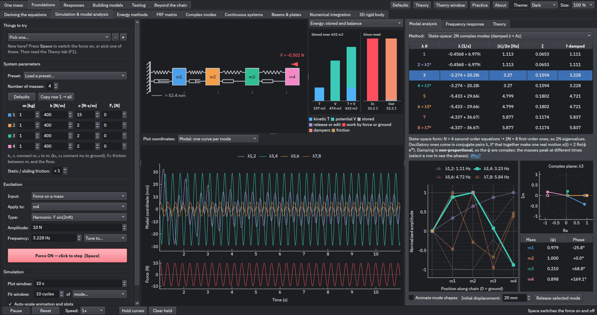

[Contents](../README.md#contents)

# The window

| Area | What it holds |
|---|---|
| **Left** | System parameters (m, k, c for each element and friction Ff for each mass, 1 to 8 masses), the excitation (a force on a mass, or motion of the ground), and simulation controls (run/pause, speed, plot window, auto-scale) |
| **Centre** | Animation of the chain (with a scale bar for the real displacement) and live energy bars, above time histories of the applied force and of the motion (in physical or modal coordinates), of the energy, or of the force in each spring and damper |
| **Right** | Tabs: *Modal analysis* (table, mode shapes, release), *Frequency response*, and *Theory* (notes written for students) |
| **Top** | The pages, in six groups, and the *Theory*, *Theory window*, *About*, *Theme* and *Size* controls |

The pages are grouped in the order they are meant to be read, each using only ideas from the pages
before it (Ctrl+1 to Ctrl+6 jump to a group). The first run opens on the first, *Single oscillator*, at
its Theory: the map of the course (which counts each page's practice problems solved), four shorter *paths*
through it (Essentials, Testing, Rotating machinery, Vibration environments: each with every page its pages
build on), then *How a page works* and the keys (the *About* box lists the keys too). Ctrl+= and Ctrl+− (or Ctrl and the mouse wheel) make the notes' text, equations and figures larger or smaller in every Theory tab and the Theory window, and Ctrl+0 puts them back; the size is remembered. The *Theory window* (Ctrl+F1) shows any page's Theory in a
window of its own, with the pages and their sections listed, a *Glossary of symbols* at the top, and a search
box (Ctrl+F) that finds a word or a symbol in every page's notes: it keeps its place as you move between pages,
or follows them:

1. **One mass.** **Single oscillator** (free decay, damping, resonance, half-power bandwidth, beats and
   poles, on one mass), **Pendulums** (gravity as the spring, and large swings), **Transient response**
   (an impulse, a step or a pulse: the impulse response, Duhamel's integral, and how long a pulse has to
   be), **Periodic forcing** (a repeating force as a Fourier series), **Damping models** (viscous, hysteretic, friction
   and viscoelastic damping matched to one another: their loops, losses and decays) and **Vibration
   isolation** (a machine on mounts: transmissibility, static deflection, damping, two stages, start-up).
2. **Foundations.** **Deriving the equations** (a car's body in bounce and pitch, and a double pendulum,
   by free-body diagrams and by Lagrange, in any coordinates), *Simulation & modal analysis* (the chain above), **Energy methods** (Rayleigh,
   Dunkerley, Rayleigh–Ritz and Holzer), **FRF matrix** (every term of the receptance matrix and how the
   modes build it up), **Complex modes** (when the damping makes the modes complex, and what the usual
   approximation then misses), **Continuous systems** (the chain refined into a string, a bar or a beam,
   to show which of its modes to trust), **Beams & plates** (thick beams and plates) and **Numerical
   integration** (what the usual time-stepping schemes do to a vibration).
3. **Responses.** **Random vibration** (a random force or base: the response's spectrum, RMS and peaks),
   **Fatigue** (rainflow, Miner and the spectral estimates), **Quarter-car** (a suspension on a rough
   road), **Rigid body on mounts** (a machine's six coupled modes on four mounts, and decoupling them),
   **Shock spectrum** (a pulse on a bank of single oscillators, and on the chain) and **Seismic
   response** (the chain as a building under a design spectrum).
4. **Building models.** **Modal coupling** (two halves of the chain joined one mode each, to show when
   their modes split), **Substructuring (CMS)** (the chain reduced by component mode synthesis:
   Craig–Bampton, Rubin or MacNeal) and **Frame builder** (a plane frame or truss drawn on a grid from
   beams, bars, springs and masses, its matrices assembled element by element, and its modes).
5. **Testing.** **Signals & spectra** (sampling, aliasing, leakage, windows,
   averaging, and the transducers that make the signals), **Virtual modal test** (the FRF measured from simulated force and response signals, as in
   a lab), **Operational modal analysis** (the modes from the responses to unmeasured ambient forces
   alone), **Model updating** (a model with errors in it correlated against a modal test of the chain,
   and updated to find them), **Test planning** (where to put the sensors, by effective independence, and
   the operational deflection shape at a running frequency), **Nonlinearity & forces** (is the chain linear:
   levels, sweeps up and down, harmonics; and which force made a measured response) and **Variability &
   localization** (scatter in the chain by Monte Carlo,
   and a mistuned ring of blades).
6. **Beyond the chain.** **Torsional vibration** (a drive train of discs, shafts and gear meshes, and its
   start-up), **Duffing & Mathieu** (a single mass on a nonlinear spring, driven through its jump or pumped
   into parametric resonance), **Self-excited vibration** (van der Pol, galloping, vortex shedding and
   flutter), **Active control** (feedback on the chain against a tuned mass damper), the **Gyroscope** (a
   spinning top: precession, nutation and the sleeping top, then on a table: the rising top and the tippe top), the
   **Jeffcott rotor**
   (a disc on a flexible shaft in flexible bearings) and **Machinery diagnostics** (orders, sidebands,
   envelopes and the cepstrum).

Every page has a *Theory* tab (the *Theory* button or F1 opens it) that starts with what to read first,
links to the sections it builds on, and ends with *Things to try*, *What to take away*, a table of the
page's symbols and books to read further (the pages are being brought to this form one by one). Most pages'
*Things to try* are one click: pick one from the box at the top left and the page sets itself up. On the
One mass pages (so far) some ask you to predict first: the question and its choices show in the box, and the page
sets up only once you've picked one (or pressed *Just run it*), with the verdict above the note that
explains it. Their notes also open with *On this page you'll*, two or three goals, each with a link
that sets up its Thing to try and one that asks its practice problem. All of them are described below.

Vibration isolation, Quarter-car, Active control, the Frame builder and the Jeffcott rotor also have a
*Challenge* box under their Things to try: a spec to meet with the page's own controls (an isolation at a
speed, a damper for comfort and grip). Pick one and the page sets up where it starts; as you tune, each
requirement is ticked or crossed with what the page has now, and once all are met it counts as solved,
as in the Practice window. *Start over* sets it up again, *New numbers* asks it afresh.

## A plot's data

Right-click a plot for its menu: **Copy data as CSV** puts its curves on the clipboard, to paste into a
spreadsheet; **Save data as CSV…** writes them to a file, an x and a y column for each curve, named after
the plot's axes and the curve's legend; **Save image as PNG…** saves the plot as it shows; **Show all**
fits the plot to its data again after a zoom. **Hold these curves** keeps a grey dashed copy of what the plot
shows behind it: change a control and compare the new curves with the held ones (hold again to add more).
**Clear held curves** takes them off, as *Defaults* does. (The frame and rotor builders' canvases keep their
own right-click, which edits them.)

A line with a ◆ grip, or a dot that grows under the mouse, can be dragged: the drive's frequency on the
Single oscillator's Bode plot, the running speed on Vibration isolation's transmissibility, the damper on
Quarter-car's trade-off and damper sweep, the speed on the Jeffcott rotor's Campbell diagram, the trial
frequency in Energy methods' Holzer tab, the oscillator picked on the Shock spectrum, and the instant on the
Gyroscope's and 3D rigid body's component plots. The page's own box follows the drag, and the drag the box.

The Single oscillator draws the mass itself above its time plots, moving with the free vibration or the
driven response: **Start** plays it (Space; at ¼ speed to begin with, as a 3 Hz swing is a blur), **Reset**
takes it back to t = 0, and the time cursor on the plot it follows can be dragged to scrub. Drag the mass
sideways and let go to pluck it: it vibrates freely from where you let go. Pendulums does the same with
the pendulum (a bob, a rod, a disc on its wire seen from above, an inverted arm), swinging beside a faint
ghost of the linearized swing: turn it about its pivot and let go to start it from that angle, either side.
Damping models' *Free decay* tab draws its four masses side by side, each on its own damper, moving with
their decays: pull one and let go, and all four start from there. Vibration isolation's *Start-up* tab draws
the machine on its mounts, running up with its unbalance turning: pull it and let go and, stopped, it rings
on its mounts.

## Themes

*Theme* (top right) switches the whole app between **Light**, **Dark**, **Solarized** and
**Nord**, live, without resetting the simulation. **System** (the default) follows the
desktop's light or dark setting, and changes with it. Each theme has its own palettes for
the masses, modes and substructures, chosen so every curve, label and table entry stays
legible on its background. The choice is remembered.

## Size, for presenting

*Size* (top right, beside *Theme*) draws the whole app larger, for a projector or a TV across the room:
**125 %**, **150 %** or **200 %**. Text, lines, markers, plots and figures all grow together, as on a
high-resolution screen, so every page looks as it does at 100 %, only larger. The app restarts to change
it, back on the page it showed; the choice is remembered. At 150 % the window needs a screen about
1,700 px wide (a 1080p projector or TV), and a size the screen can't hold is refused. If the app opens on
a smaller screen than the size was picked for, it goes back to 100 %. The notes' text has its own size as
well (Ctrl+= and Ctrl+-), for reading closely at any size.

**F5** (*Present*) folds every page's side panes away: once for the controls (the plots take their room), again
for the right-hand tabs too (the main plots the whole width), and once more for all of them back. The window
then needs less room: about 760 px wide without the controls and 740 without either side, against 1,184, so a
larger *Size* fits a smaller screen (its height, about 660 px, is still the plots'). The choice is remembered,
across the restart a new *Size* takes.

## Defaults

*Defaults* (top right, or Ctrl+R) puts the page showing back as it first opened: every control as it was,
*Things to try* back at *Pick one…*, the motion at rest waiting for *Start* (or a mode shape swinging, on
a page that opens showing one). A page that shows the chain puts back the chain it opened with too, on the
Simulation page and every other page that shows it. The tab you're on stays.

---

[Contents](../README.md#contents)
