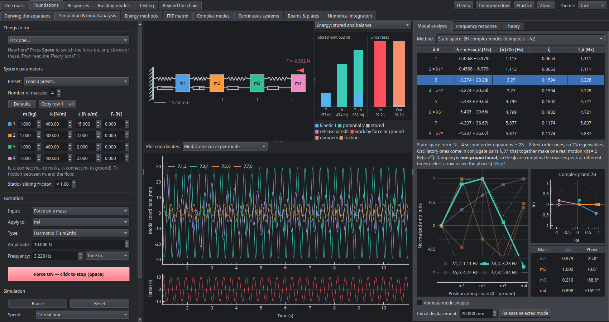

[Contents](../README.md#contents)

# The window

| Area | What it holds |
|---|---|
| **Left** | System parameters (m, k, c for each element and friction Ff for each mass, 1 to 8 masses), the excitation (a force on a mass, or motion of the ground), and simulation controls (run/pause, speed, plot window, auto-scale) |
| **Centre** | Animation of the chain (with a scale bar for the real displacement) and live energy bars, above time histories of the applied force and of the motion (in physical or modal coordinates), of the energy, or of the force in each spring and damper |
| **Right** | Tabs: *Modal analysis* (table, mode shapes, release), *Frequency response*, and *Theory* (notes written for students) |
| **Top** | The pages, in six groups, and the *Theory*, *Theory window*, *About* and *Theme* controls |

The pages are grouped in the order they are meant to be read, each using only ideas from the pages
before it (Ctrl+1 to Ctrl+6 jump to a group). The first run opens on the first, *Single oscillator*, at
its Theory: the map of the course (which counts each page's practice problems solved), four shorter *paths*
through it (Essentials, Testing, Rotating machinery, Vibration environments: each with every page its pages
build on), then *How a page works* and the keys (the *About* box lists the keys too). Ctrl+= and Ctrl+− (or Ctrl and the mouse wheel) make the notes' text, equations and figures larger or smaller in every Theory tab and the Theory window, and Ctrl+0 puts them back; the size is remembered. The *Theory window* (Ctrl+F1) shows any page's Theory in a
window of its own, with the pages and their sections listed, a *Glossary of symbols* at the top, and a search
box (Ctrl+F) that finds a word or a symbol in every page's notes: it keeps its place as you move between pages,
or follows them:

1. **One mass.** **Single oscillator** (free decay, damping, resonance, half-power bandwidth, beats and
   poles, on one mass), **Pendulums** (gravity as the spring, and large swings), **Transient response**
   (an impulse, a step or a pulse: the impulse response, Duhamel's integral, and how long a pulse has to
   be), **Periodic forcing** (a repeating force as a Fourier series), **Damping models** (viscous, hysteretic, friction
   and viscoelastic damping matched to one another: their loops, losses and decays) and **Vibration
   isolation** (a machine on mounts: transmissibility, static deflection, damping, two stages, start-up).
2. **Foundations.** **Deriving the equations** (a car's body in bounce and pitch, and a double pendulum,
   by free-body diagrams and by Lagrange, in any coordinates), *Simulation & modal analysis* (the chain above), **Energy methods** (Rayleigh,
   Dunkerley, Rayleigh–Ritz and Holzer), **FRF matrix** (every term of the receptance matrix and how the
   modes build it up), **Complex modes** (when the damping makes the modes complex, and what the usual
   approximation then misses), **Continuous systems** (the chain refined into a string, a bar or a beam,
   to show which of its modes to trust), **Beams & plates** (thick beams and plates) and **Numerical
   integration** (what the usual time-stepping schemes do to a vibration).
3. **Responses.** **Random vibration** (a random force or base: the response's spectrum, RMS and peaks),
   **Fatigue** (rainflow, Miner and the spectral estimates), **Quarter-car** (a suspension on a rough
   road), **Rigid body on mounts** (a machine's six coupled modes on four mounts, and decoupling them),
   **Shock spectrum** (a pulse on a bank of single oscillators, and on the chain) and **Seismic
   response** (the chain as a building under a design spectrum).
4. **Building models.** **Modal coupling** (two halves of the chain joined one mode each, to show when
   their modes split), **Substructuring (CMS)** (the chain reduced by component mode synthesis:
   Craig–Bampton, Rubin or MacNeal) and **Frame builder** (a plane frame or truss drawn on a grid from
   beams, bars, springs and masses, its matrices assembled element by element, and its modes).
5. **Testing.** **Signals & spectra** (sampling, aliasing, leakage, windows,
   averaging, and the transducers that make the signals), **Virtual modal test** (the FRF measured from simulated force and response signals, as in
   a lab), **Operational modal analysis** (the modes from the responses to unmeasured ambient forces
   alone), **Model updating** (a model with errors in it correlated against a modal test of the chain,
   and updated to find them), **Test planning** (where to put the sensors, by effective independence, and
   the operational deflection shape at a running frequency), **Nonlinearity & forces** (is the chain linear:
   levels, sweeps up and down, harmonics; and which force made a measured response) and **Variability &
   localization** (scatter in the chain by Monte Carlo,
   and a mistuned ring of blades).
6. **Beyond the chain.** **Torsional vibration** (a drive train of discs, shafts and gear meshes, and its
   start-up), **Duffing & Mathieu** (a single mass on a nonlinear spring, driven through its jump or pumped
   into parametric resonance), **Self-excited vibration** (van der Pol, galloping, vortex shedding and
   flutter), **Active control** (feedback on the chain against a tuned mass damper), the **Gyroscope** (a
   spinning top: precession, nutation and the sleeping top, then on a table: the rising top and the tippe top), the
   **Jeffcott rotor**
   (a disc on a flexible shaft in flexible bearings) and **Machinery diagnostics** (orders, sidebands,
   envelopes and the cepstrum).

Every page has a *Theory* tab (the *Theory* button or F1 opens it) that starts with what to read first,
links to the sections it builds on, and ends with *Things to try*, *What to take away*, a table of the
page's symbols and books to read further (the pages are being brought to this form one by one). Most pages'
*Things to try* are one click: pick one from the box at the top left and the page sets itself up. All of
them are described below.

## Themes

*Theme* (top right) switches the whole app between **Light**, **Dark**, **Solarized** and
**Nord**, live, without resetting the simulation. **System** (the default) follows the
desktop's light or dark setting, and changes with it. Each theme has its own palettes for
the masses, modes and substructures, chosen so every curve, label and table entry stays
legible on its background. The choice is remembered.

---

[Contents](../README.md#contents)
